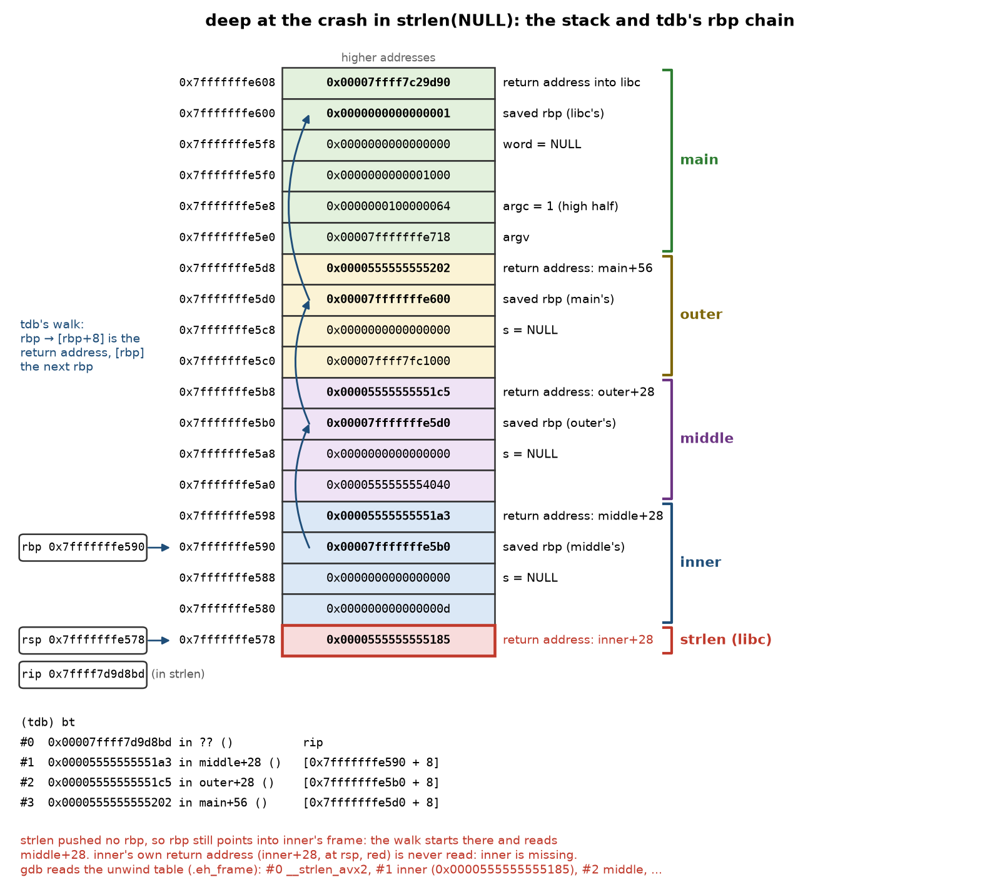

# Chapter 5 — Crashes and Post-Mortem

learn-c, Chapter 10 ran `bt` on a crash in your own code. Real crashes happen inside the C
library, or in `abort()` with a message about a stack you never touched, or come from a
timer. Some programs just spin, and some crashed yesterday on another machine. This chapter
covers each case with gdb:
backtraces through libc, moving between frames, the kernel's own report in `$_siginfo`, the
stack canary, how gdb handles signals (`handle`, `catch signal`, `signal 0`), attaching to a
running process with `gdb -p`, core files and `gcore`, and AddressSanitizer under gdb. tdb
gets the same tools in miniature. It gains a backtrace that follows the chain of saved frame
pointers, a `siginfo` command built on `PTRACE_GETSIGINFO`, gdb's signal table (`handle`,
`info signals`), and `attach`, `detach` and `tdb -p PID` on top of `PTRACE_ATTACH`.

Previous: [Chapter 4](04-watchpoints-and-catchpoints.md). Next: [Chapter 6](06-down-to-the-metal.md).

## A crash inside the C library

The examples are in `examples/ch05/`. `make` builds them with `-std=c11 -Wall -Wextra -g -O0`.

`examples/ch05/ages.c`
```c
/* ages.c - read "name,age" lines and print the average age.
 *
 *     ./ages people.txt
 *
 * Bug: it crashes with a segmentation fault, inside the C library.
 * Find which line of people.txt it was reading, and why.
 */
#include <stdio.h>
#include <stdlib.h>
#include <string.h>

struct person {
    char name[32];
    int age;
};

/* Split "name,age" into p. */
static void parse_line(char *line, struct person *p)
{
    char *name = strtok(line, ",\n");
    char *age = strtok(NULL, ",\n");

    snprintf(p->name, sizeof p->name, "%s", name);
    p->age = atoi(age);
}

int main(int argc, char **argv)
{
    char line[128];
    struct person p;
    int total = 0, count = 0;
    FILE *f;

    if (argc != 2) {
        fprintf(stderr, "usage: %s FILE\n", argv[0]);
        return 2;
    }
    f = fopen(argv[1], "r");
    if (f == NULL) {
        perror(argv[1]);
        return 1;
    }
    while (fgets(line, sizeof line, f) != NULL) {
        parse_line(line, &p);
        total += p.age;
        count++;
    }
    fclose(f);
    printf("%d people, average age %.1f\n", count, (double)total / count);
    return 0;
}
```

`examples/ch05/people.txt`
```text
alice,34
bob,27
carol
dave,41
```

```console
$ ./ages people.txt
Segmentation fault      (core dumped) ./ages people.txt
$ echo $?
139
```

Exit status 139 is 128 + 11, and 11 is `SIGSEGV`. "(core dumped)" means the kernel produced a
core dump. Whether you can find it as a file depends on the system (see "Core files" below).
For now, run it under gdb:

```console
$ gdb -q ./ages
Reading symbols from ./ages...
(gdb) run people.txt
Starting program: .../ages people.txt
...
Program received signal SIGSEGV, Segmentation fault.
__GI_____strtol_l_internal (nptr=0x0, endptr=endptr@entry=0x0, base=base@entry=10, group=group@entry=0, loc=0x7ffff7e1b580 <_nl_global_locale>) at ../stdlib/strtol_l.c:291
291	../stdlib/strtol_l.c: No such file or directory.
(gdb) bt
#0  __GI_____strtol_l_internal (nptr=0x0, endptr=endptr@entry=0x0, base=base@entry=10, 
    group=group@entry=0, loc=0x7ffff7e1b580 <_nl_global_locale>) at ../stdlib/strtol_l.c:291
#1  0x00007ffff7c474f6 in __strtol (nptr=<optimized out>, endptr=endptr@entry=0x0, 
    base=base@entry=10) at ../stdlib/strtol.c:106
#2  0x00007ffff7c43654 in __GI_atoi (nptr=<optimized out>) at ./stdlib/atoi.c:27
#3  0x00005555555552df in parse_line (line=0x7fffffffe360 "carol", p=0x7fffffffe330) at ages.c:24
#4  0x00005555555553cd in main (argc=2, argv=0x7fffffffe508) at ages.c:44
```

(Addresses and PIDs vary. The path after `Starting program:` and gdb's libthread_db
messages are cut to `...`.)

The program stopped in a function you never wrote, in a file you do not have. That is
normal: "No such file or directory" only means that glibc's source is not installed. The
names, arguments and line numbers come from glibc's debug info, which gdb finds with
`libc6-dbg` installed (`sudo apt install libc6-dbg`). Read a backtrace from the top down to
the first frame in your own code, `#3 parse_line ... at ages.c:24`. The frames above it say
what went wrong: `atoi` called `strtol` with `nptr=0x0`, a NULL string. Frame #3 says who did
it and on which input: `line="carol"`, the line without an age. (`@entry` means "the value
this argument had when the function was entered", which gdb can sometimes recover after the
register has been reused.)

Without libc's debug info the libc frames lose their names and arguments, but the backtrace
is still complete. You can simulate that by pointing gdb at an empty debug directory:

```console
$ gdb -q -batch -iex 'set debug-file-directory /nonexistent' -iex 'set debuginfod enabled off' -ex 'run people.txt' -ex bt ./ages
...
Program received signal SIGSEGV, Segmentation fault.
0x00007ffff7c47580 in ?? () from /lib/x86_64-linux-gnu/libc.so.6
#0  0x00007ffff7c47580 in ?? () from /lib/x86_64-linux-gnu/libc.so.6
#1  0x00007ffff7c43654 in atoi () from /lib/x86_64-linux-gnu/libc.so.6
#2  0x00005555555552df in parse_line (line=0x7fffffffe500 "carol", p=0x7fffffffe4d0) at ages.c:24
#3  0x00005555555553cd in main (argc=2, argv=0x7fffffffe6a8) at ages.c:44
```

`??` is the internal `strtol`, which is not in libc's exported symbol table; `atoi` is
exported and keeps its name. `__strtol` is gone because it was never a real frame: it ends
with a `jmp` to the internal function (a *tail call*), which gdb reconstructs only with debug
info (`info frame` calls it a "tail call frame"). How gdb walks through libc at all without
debug info is explained in "How a backtrace works"; tdb's simpler method fails right here.

## Moving between frames

When a program stops, gdb's *selected frame* is #0. `print` and `info locals` look up names
there, so the variables of `parse_line` are out of reach:

```console
(gdb) print age
No symbol "age" in current context.
(gdb) frame 3
#3  0x00005555555552df in parse_line (line=0x7fffffffe360 "carol", p=0x7fffffffe330) at ages.c:24
24	    p->age = atoi(age);
(gdb) info locals
name = 0x7fffffffe360 "carol"
age = 0x0
(gdb) up
#4  0x00005555555553cd in main (argc=2, argv=0x7fffffffe508) at ages.c:44
44	        parse_line(line, &p);
(gdb) print count
$1 = 2
(gdb) print total
$2 = 61
```

`frame N` selects frame N. `up` goes one frame towards `main` (the caller), `down` one back
towards #0; both take a count (`up 2`). `frame function NAME` selects the innermost frame of
that function, handy when frame numbers change between runs, and a bare `frame` prints where
you are. Selecting a frame does not change the program. It changes where gdb looks up names,
registers (`$rip`, `$rsp`, `$rbp` *for that frame*) and the lines `list` shows.

`age = 0x0` is the cause: `strtok` returns NULL when there is no further field, and
`atoi(NULL)` is undefined behaviour (glibc's `strtol` simply reads address 0). `count = 2` and
`total = 61` (34 + 27) confirm that carol's was the third line. The fix: `parse_line` becomes
`int` and returns -1 when `name == NULL || age == NULL`, and `main` counts lines:

```c
        lineno++;
        if (parse_line(line, &p) < 0) {
            fprintf(stderr, "%s:%d: expected NAME,AGE\n", argv[1], lineno);
            continue;
        }
```

`./ages-fixed people.txt` prints `people.txt:3: expected NAME,AGE` on stderr, then
`3 people, average age 34.0`.

## What the kernel told the program: $_siginfo

When the kernel sends a signal it also fills in a `siginfo_t`: which signal, why, and for a
fault, which address. gdb shows it as the convenience variable `$_siginfo`:

```console
(gdb) print $_siginfo.si_signo
$3 = 11
(gdb) print $_siginfo.si_code
$4 = 1
(gdb) print $_siginfo._sifields._sigfault.si_addr
$5 = (void *) 0x0
```

`si_signo = 11` is `SIGSEGV`. `si_code = 1` is `SEGV_MAPERR`: nothing is mapped at that
address. The other common code is 2, `SEGV_ACCERR`: the page exists but the access is not
allowed, such as a write to a string literal. `si_addr` is the address the instruction tried
to touch. 0x0 is a NULL pointer, a small value such as 0x10 is usually NULL plus a member
offset (`p->field`), and a value near `$rsp` usually means the stack overflowed.

`print $_siginfo` with no field prints the whole union. Only the member for the current
signal makes sense: `_sigfault` for SIGSEGV, SIGBUS, SIGILL and SIGFPE, and `_kill` (`si_pid`,
`si_uid`) for signals sent by another process.

## Stack smashing

`examples/ch05/greet.c`
```c
/* greet.c - print a greeting card for each name on the command line.
 *
 *     ./greet Ann Maximilian-Alexander
 *
 * Bug: a long name ends the program with "*** stack smashing detected ***".
 * The crash comes when format_card returns; find the write that did it.
 */
#include <stdio.h>
#include <string.h>

static void format_card(const char *name)
{
    char card[24];

    strcpy(card, "Dear ");
    strcat(card, name);
    strcat(card, ",");
    puts(card);
}

int main(int argc, char **argv)
{
    for (int i = 1; i < argc; i++)
        format_card(argv[i]);
    return 0;
}
```

```console
$ ./greet Ann Maximilian-Alexander
Dear Ann,
Dear Maximilian-Alexander,
*** stack smashing detected ***: terminated
Aborted                 (core dumped) ./greet Ann Maximilian-Alexander
$ echo $?
134
```

"Dear Maximilian-Alexander," is 26 characters plus the NUL, 27 bytes in a 24-byte array. The
program printed the whole card and only then died: the overflow went unnoticed until
`format_card` returned. 134 is 128 + 6, `SIGABRT`. Under gdb:

```console
(gdb) run Ann Maximilian-Alexander
Starting program: .../greet Ann Maximilian-Alexander
[Thread debugging using libthread_db enabled]
Using host libthread_db library "/lib/x86_64-linux-gnu/libthread_db.so.1".
...
*** stack smashing detected ***: terminated

Program received signal SIGABRT, Aborted.
__pthread_kill_implementation (no_tid=0, signo=6, threadid=140737353811776) at ./nptl/pthread_kill.c:44
44	./nptl/pthread_kill.c: No such file or directory.
(gdb) bt
...
#4  0x00007ffff7c287f3 in __GI_abort () at ./stdlib/abort.c:79
#5  0x00007ffff7c89637 in __libc_message (action=action@entry=do_abort, 
    fmt=fmt@entry=0x7ffff7ddb947 "*** %s ***: terminated\n") at ../sysdeps/posix/libc_fatal.c:156
#6  0x00007ffff7d3662a in __GI___fortify_fail (
    msg=msg@entry=0x7ffff7ddb92f "stack smashing detected") at ./debug/fortify_fail.c:26
#7  0x00007ffff7d365f6 in __stack_chk_fail () at ./debug/stack_chk_fail.c:24
#8  0x0000555555555227 in format_card (name=0x7fffffffe874 "Maximilian-Alexander") at greet.c:19
#9  0x0000555555555264 in main (argc=3, argv=0x7fffffffe4f8) at greet.c:24
```

Frames #0 to #3 (cut) are `pthread_kill` and `raise`: every `abort()` raises `SIGABRT` against
its own thread. #5 to #7 say who called it: `__stack_chk_fail`. The first frame of your own code
is #8, and its line is 19, the closing `}`. The backtrace says where the damage was *found*. It
does not say where it was *done*.

### The canary

Ubuntu's gcc enables `-fstack-protector-strong` by default (`gcc -Q --help=common` lists it as
`[enabled]`). It protects every function with a local array. `disassemble /s` shows the
machine code under each source line (Chapter 6 reads these listings in detail):

```console
(gdb) disassemble /s format_card
Dump of assembler code for function format_card:
greet.c:
12	{
   0x00000000000011a9 <+0>:	endbr64 
   0x00000000000011ad <+4>:	push   %rbp
   0x00000000000011ae <+5>:	mov    %rsp,%rbp
   0x00000000000011b1 <+8>:	sub    $0x30,%rsp
   0x00000000000011b5 <+12>:	mov    %rdi,-0x28(%rbp)
   0x00000000000011b9 <+16>:	mov    %fs:0x28,%rax
   0x00000000000011c2 <+25>:	mov    %rax,-0x8(%rbp)
   0x00000000000011c6 <+29>:	xor    %eax,%eax

13	    char card[24];
14	
15	    strcpy(card, "Dear ");
   0x00000000000011c8 <+31>:	lea    -0x20(%rbp),%rax
...
19	}
   0x0000000000001212 <+105>:	nop
   0x0000000000001213 <+106>:	mov    -0x8(%rbp),%rax
   0x0000000000001217 <+110>:	sub    %fs:0x28,%rax
   0x0000000000001220 <+119>:	je     0x1227 <format_card+126>
   0x0000000000001222 <+121>:	call   0x10a0 <__stack_chk_fail@plt>
   0x0000000000001227 <+126>:	leave  
   0x0000000000001228 <+127>:	ret    
End of assembler dump.
```

(Lines 15 to 18 are cut. Before `run`, the addresses are offsets in the file.)

At +16 and +25 the prologue copies 8 bytes from `%fs:0x28` into `-0x8(%rbp)`. `%fs` points at
the thread's control block, where glibc stores a random value at start-up: the *canary*.
`card` is at `-0x20(%rbp)`, 24 bytes up to -0x9, so an overflow of `card` goes through the
canary before it reaches the saved `%rbp` and the return address. Before `leave; ret` the
function compares the slot with `%fs:0x28` and calls `__stack_chk_fail` if they differ. The
canary does not prevent the overflow. It prevents a return through a damaged return address.

### Catching the write

The damaged address is known, `$rbp - 8` in `format_card`, so a Chapter 4 watchpoint can
catch the write. Stop on line 15, after the prologue, at the second call:

```console
(gdb) break greet.c:15
Breakpoint 1 at 0x5555555551c8: file greet.c, line 15.
(gdb) run
...
Breakpoint 1, format_card (name=0x7fffffffe870 "Ann") at greet.c:15
15	    strcpy(card, "Dear ");
(gdb) continue
Continuing.
Dear Ann,

Breakpoint 1, format_card (name=0x7fffffffe874 "Maximilian-Alexander") at greet.c:15
15	    strcpy(card, "Dear ");
(gdb) print/x *(unsigned long *)($rbp - 8)
$2 = 0x1dd7f6d29a5f2600
(gdb) print/x *(unsigned long *)($fs_base + 0x28)
$3 = 0x1dd7f6d29a5f2600
(gdb) set output-radix 16
Output radix now set to decimal 16, hex 10, octal 20.
(gdb) watch -l *(unsigned long *)($rbp - 8)
Hardware watchpoint 2: -location *(unsigned long *)($rbp - 8)
(gdb) continue
Continuing.

Hardware watchpoint 2: -location *(unsigned long *)($rbp - 8)

Old value = 0x1dd7f6d29a5f2600
New value = 0x1dd7f6d29a5f0072
__strcat_avx2 () at ../sysdeps/x86_64/multiarch/strcpy-avx2.S:639
639	../sysdeps/x86_64/multiarch/strcpy-avx2.S: No such file or directory.
(gdb) up
#1  0x00005555555551eb in format_card (name=0x7fffffffe874 "Maximilian-Alexander") at greet.c:16
16	    strcat(card, name);
(gdb) print card
$4 = "Dear Maximilian-Alexande"
(gdb) x/8xb $rbp - 8
0x7fffffffe3a8:	0x72	0x00	0x5f	0x9a	0xd2	0xf6	0xd7	0x1d
```

`$fs_base + 0x28` is the original canary; it differs in every run, and its lowest byte is
always `0x00`, so a string copy that stops at a NUL cannot reproduce it. `set output-radix 16`
prints values in hex. `watch -l` watches the address, not the expression `$rbp - 8`, which
would mean something else in every frame. The write is in `__strcat_avx2` (the `strcat` that
glibc picked for this CPU), called from line 16: `card` holds 24 characters and no NUL, and
the rest, `'r'` and the NUL, landed on the canary's two low bytes. One more `continue` catches
line 17's `","` (gcc inlined that `strcat` as a 2-byte store), then the program aborts.

One fix is `snprintf`, which never writes more than the size you give it:

```c
    snprintf(card, sizeof card, "Dear %s,", name);
```

`./greet-fixed Ann Maximilian-Alexander` prints "Dear Ann," and "Dear Maximilian-Alexand":
it truncates. Whether that is acceptable is the program's decision. A bigger buffer or
rejecting the name are the alternatives, but the length check is now in one place.

## Signals and the debugger

`examples/ch05/progress.c`
```c
/* progress.c - a long computation that prints a progress line ten times a
 * second, driven by a SIGALRM timer.
 *
 *     ./progress
 *
 * Bug: it prints the first progress line and then dies with "Alarm clock".
 * The handler is installed; why does the second SIGALRM kill it?
 */
#include <signal.h>
#include <stdio.h>
#include <sys/time.h>

#define STEPS 400000000L

static volatile sig_atomic_t report_due;

static void on_alarm(int sig)
{
    (void)sig;
    report_due = 1;
}

int main(void)
{
    struct itimerval tenth = { { 0, 100000 }, { 0, 100000 } };
    unsigned long sum = 0;

    signal(SIGALRM, on_alarm);
    setitimer(ITIMER_REAL, &tenth, NULL);
    for (long i = 0; i < STEPS; i++) {
        sum += (unsigned long)i * i % 7;
        if (report_due) {
            report_due = 0;
            printf("%3ld%% done\n", i * 100 / STEPS);
            fflush(stdout);
        }
    }
    printf("sum = %lu\n", sum);
    return 0;
}
```

```console
$ ./progress
 13% done
Alarm clock             ./progress
$ echo $?
142
```

The percentage varies. 142 is 128 + 14, `SIGALRM`. Under gdb:

```console
(gdb) run
Starting program: .../progress 
...
 12% done

Program terminated with signal SIGALRM, Alarm clock.
The program no longer exists.
(gdb) info signals SIGALRM
Signal        Stop	Print	Pass to program	Description
SIGALRM       No	No	Yes		Alarm clock
```

gdb did not stop at all. It keeps three settings per signal. **Stop**: give you a prompt.
**Print**: say "Program received signal ..." (stop implies print). **Pass**: deliver the
signal to the program when it resumes. With "No" gdb discards it. Faults such as `SIGSEGV` are
"Yes Yes Yes". Signals that programs use routinely (`SIGALRM`, `SIGCHLD`, `SIGWINCH`) are "No
No Yes", or the debugger would be unusable. `SIGINT` and `SIGTRAP` are "Yes Yes No": Ctrl-C
stops the program without killing it (learn-c, Chapter 10), and `SIGTRAP` is how breakpoints
report (Chapter 2). `info signals` alone prints the whole table. `handle` changes a row:

```console
(gdb) handle SIGALRM stop print
Signal        Stop	Print	Pass to program	Description
SIGALRM       Yes	Yes	Yes		Alarm clock
(gdb) run
...
Program received signal SIGALRM, Alarm clock.
0x0000555555555280 in main () at progress.c:31
31	        sum += (unsigned long)i * i % 7;
(gdb) continue
Continuing.

Program received signal SIGALRM, Alarm clock.
on_alarm (sig=1819177588) at progress.c:18
18	{
(gdb) bt
#0  on_alarm (sig=1819177588) at progress.c:18
#1  <signal handler called>
#2  0x0000555555555280 in main () at progress.c:31
(gdb) continue
Continuing.

Program terminated with signal SIGALRM, Alarm clock.
The program no longer exists.
```

The timer does not stop when your program does: `ITIMER_REAL` counts wall-clock time, so the
next `SIGALRM` was pending while you read the first stop, and it arrived as the handler was
entered. `<signal handler called>` is the frame the kernel builds to deliver a signal: the
interrupted registers, saved on the stack, and a return into code that restores them.
(`sig=1819177588` is garbage because the stop is at the `{`, before the prologue stores
`%edi`.) The second signal **killed the program although a handler was installed**. That is
the bug.

To see what `signal()` asked the kernel for, catch its system call (Chapter 4). At the entry,
`%rsi` points at the kernel's `struct sigaction`: handler, flags, restorer, mask.

```console
(gdb) handle SIGALRM nostop noprint
...
(gdb) catch syscall rt_sigaction
Catchpoint 1 (syscall 'rt_sigaction' [13])
(gdb) run
...
Catchpoint 1 (call to syscall rt_sigaction), 0x00007ffff7c425f3 in __GI___libc_sigaction (sig=14, act=act@entry=0x7fffffffe270, oact=oact@entry=0x7fffffffe310) at ../sysdeps/unix/sysv/linux/libc_sigaction.c:58
58	../sysdeps/unix/sysv/linux/libc_sigaction.c: No such file or directory.
(gdb) x/4gx $rsi
0x7fffffffe120:	0x00005555555551c9	0xffffffffe4000000
0x7fffffffe130:	0x00007ffff7c42520	0x0000000000000000
(gdb) info symbol ((unsigned long *)$rsi)[0]
on_alarm in section .text of .../progress
```

The flags are `0xe4000000` (the upper half is an `int`'s sign extension): `SA_RESETHAND`
(0x80000000, reset to the default action when the handler is entered), `SA_NODEFER`
(0x40000000, do not block the signal in its handler), `SA_INTERRUPT` (0x20000000, historical)
and `SA_RESTORER` (0x04000000, glibc supplies the return code, the third word).
`SA_RESETHAND` is the bug: after one run of the handler, `SIGALRM` terminates again. These are
the System V semantics of `signal()`. signal(2) explains that glibc gives BSD semantics (the
handler stays, plus `SA_RESTART`) only when `_DEFAULT_SOURCE` is defined, which `-std=c11`
(this Makefile) and `-std=c99` turn off. With `-std=gnu11` the same call sets `0x14000000`
(`SA_RESTART | SA_RESTORER`). The portable fix is `sigaction` plus a feature-test macro:

```diff
+#define _POSIX_C_SOURCE 200809L
 #include <signal.h>
@@
-    signal(SIGALRM, on_alarm);
+    struct sigaction sa = { .sa_handler = on_alarm };
+    sigemptyset(&sa.sa_mask);
+    sigaction(SIGALRM, &sa, NULL);
```

`./progress-fixed` prints a progress line every tenth of a second and ends with
`sum = 799999998`.

### catch signal and signal 0

`handle` is a policy for every occurrence. `catch signal` is a numbered stop point, like a
breakpoint: it can be deleted, ignored, or given a condition or commands (Chapter 2). At a
signal stop, `signal 0` resumes *without* delivering the signal:

```console
(gdb) catch signal SIGALRM
Catchpoint 1 (signal SIGALRM)
(gdb) run
...
Catchpoint 1 (signal SIGALRM), main () at progress.c:32
32	        if (report_due) {
(gdb) signal 0
Continuing with no signal.

Catchpoint 1 (signal SIGALRM), main () at progress.c:32
32	        if (report_due) {
```

The next `SIGALRM` stops it again. `handle SIGALRM nopass` discards every one: the buggy
program then runs to `sum = 799999998` and exits normally, but prints no progress because
the handler never runs. `signal SIGNAME` does the opposite and delivers a signal of your
choice, which is a quick way to test a handler.

## Attaching to a running program

Some bugs do not crash: the program stops making progress, and you did not start it in gdb.

`examples/ch05/queue.c`
```c
/* queue.c - a worker that drains a job queue, then waits for more.
 *
 *     ./queue &
 *
 * Bug: it prints "draining 7 jobs" and never "queue empty"; it uses a full
 * CPU core. Attach to it with gdb -p and see where it is stuck.
 */
#define _POSIX_C_SOURCE 200809L
#include <stdio.h>
#include <sys/prctl.h>
#include <unistd.h>

#define QSIZE 16

/* A ring buffer: jobs[head] is the next job, jobs[tail] the next free slot. */
struct queue {
    int jobs[QSIZE];
    int head;
    int tail;
};

static int done;

static void run_job(int job)
{
    done += job;
}

/* Run jobs two at a time, as the old batch code did. */
static void drain(struct queue *q)
{
    while (q->head != q->tail) {
        run_job(q->jobs[q->head]);
        run_job(q->jobs[(q->head + 1) % QSIZE]);
        q->head = (q->head + 2) % QSIZE;
    }
}

int main(void)
{
    struct queue q = { { 5, 3, 8, 1, 9, 2, 7 }, 0, 7 };

    /* Let any process of ours attach a debugger (see ptrace_scope). */
    prctl(PR_SET_PTRACER, PR_SET_PTRACER_ANY);
    printf("queue: pid %d, draining %d jobs\n", (int)getpid(), q.tail - q.head);
    fflush(stdout);
    drain(&q);
    printf("queue empty, %d done\n", done);
    return 0;
}
```

Start it in the background with `./queue &`. It prints `queue: pid N, draining 7 jobs` and
then uses a whole CPU core. Stop it with `kill %1` when you are done with this section.

First, permission. Most distributions enable the Yama security module with
`/proc/sys/kernel/yama/ptrace_scope` set to 1: a process may only trace its own
descendants. A `sleep 600 &` started from the shell is not gdb's descendant, and `gdb -p`
on it says "Could not attach to process. If your uid matches the uid of the target
process, check the setting of /proc/sys/kernel/yama/ptrace_scope, or try again as the root
user." and then "ptrace: Operation not permitted."

There are three ways around this. A program can allow a debugger with
`prctl(PR_SET_PTRACER, ...)`, as `queue.c` does in one line. Root has `CAP_SYS_PTRACE`, so
`sudo gdb -p PID` works. Or `echo 0 | sudo tee /proc/sys/kernel/yama/ptrace_scope` lowers the
setting until the next reboot, for every process on the machine: prefer the first two.

```console
$ gdb -q -p 550283
Attaching to process 550283
...
0x00006137304fa245 in drain (q=0x7fffbe4ba570) at queue.c:35
35	        q->head = (q->head + 2) % QSIZE;
(gdb) bt
#0  0x00006137304fa245 in drain (q=0x7fffbe4ba570) at queue.c:35
#1  0x00006137304fa362 in main () at queue.c:47
(gdb) break 35
Breakpoint 1 at 0x6137304fa23a: file queue.c, line 35.
(gdb) continue
Continuing.

Breakpoint 1, drain (q=0x7fffbe4ba570) at queue.c:35
35	        q->head = (q->head + 2) % QSIZE;
(gdb) print *q
$1 = {jobs = {5, 3, 8, 1, 9, 2, 7, 0, 0, 0, 0, 0, 0, 0, 0, 0}, head = 4, tail = 7}
(gdb) display q->head
1: q->head = 4
```

`continue` five more times shows `q->head` = 6, 8, 10, 12 and 14, then:

```console
(gdb) print q->tail
$2 = 7
(gdb) detach
Detaching from program: .../queue, process 550283
[Inferior 1 (process 550283) detached]
```

(The "Reading symbols" and libthread_db lines after `Attaching` are cut to `...`.) Attaching
stops the process wherever it happens to be: here line 35, in another run `run_job`. The
addresses start with 0x61..., not 0x5555..., because gdb turns off address randomization only
for programs it starts itself. The bug: `head` is always even and `tail` is 7, so `head !=
tail` holds forever (`% QSIZE` wraps 14 to 0). The fix is to run an odd job on its own, or to
loop on a count. `detach` removes the breakpoints and lets the process go, still spinning.
Exercise 3 repairs the queue *before* detaching.

## Core files

A core file is the memory and registers of a process, written to disk so that you can debug
it later, on another machine if needed. How the kernel writes one on a crash depends on two
settings (see core(5)):

- `ulimit -c` is the largest core the shell's processes may write. It is often 0 (no file);
  `ulimit -c unlimited` raises it for that shell.
- `/proc/sys/kernel/core_pattern` says where the core goes: a file name such as `core` or
  `core.%p` (`%p` is the PID), or `|program`, which pipes the core to a program (`ulimit -c`
  does not limit those). systemd-based distributions often pipe to `systemd-coredump`; then
  `coredumpctl list` shows the cores and `coredumpctl gdb` opens the latest. Ubuntu's apport
  writes a report to `/var/crash/`, and `apport-unpack` extracts the core from it.

So "(core dumped)" in the shell tells you that a dump was produced, not where it went. The way
that works everywhere is to have gdb write the core itself, with `gcore` (the long name is
`generate-core-file`):

```console
(gdb) run people.txt
...
Program received signal SIGSEGV, Segmentation fault.
__GI_____strtol_l_internal (nptr=0x0, endptr=endptr@entry=0x0, base=base@entry=10, group=group@entry=0, loc=0x7ffff7e1b580 <_nl_global_locale>) at ../stdlib/strtol_l.c:291
291	../stdlib/strtol_l.c: No such file or directory.
(gdb) gcore core.ages
warning: target file /proc/550552/cmdline contained unexpected null characters
Saved corefile core.ages
```

The warning is harmless: the arguments in `/proc/PID/cmdline` are separated by NULs. The
core (750 KB here) is an ELF file with a segment for each memory region and notes for the
registers, the signal and the file mappings. Quit, and load it next to its program:

```console
$ gdb -q ./ages core.ages
Reading symbols from ./ages...
[New LWP 550552]
...
Core was generated by `.../ages people.txt'.
Program terminated with signal SIGSEGV, Segmentation fault.
#0  __GI_____strtol_l_internal (nptr=0x0, endptr=endptr@entry=0x0, base=base@entry=10, 
    group=group@entry=0, loc=0x7ffff7e1b580 <_nl_global_locale>) at ../stdlib/strtol_l.c:291
291	../stdlib/strtol_l.c: No such file or directory.
(gdb) frame 4
#4  0x00005555555553cd in main (argc=2, argv=0x7fffffffe508) at ages.c:44
44	        parse_line(line, &p);
(gdb) print count
$3 = 2
(gdb) print $_siginfo._sifields._sigfault.si_addr
$5 = (void *) 0x0
(gdb) info registers rip
rip            0x5555555553cd      0x5555555553cd <main+228>
(gdb) continue
The program is not being run.
```

(`bt`, `frame 3`, and four `print`s are cut; `bt` gives the same five frames as before.)
Everything that reads state works: frames, variables, `$_siginfo` (gdb's core includes the
signal information) and registers, per frame (`rip` in frame 4 is the return address into
`main`). Nothing that needs a process works: a core is a photograph, and `run` would start a
*new* process without the core's arguments. A core is only useful with the exact binary that
produced it, preferably with its debug info, so keep the `-g` build (or its separate debug
file) of every binary you ship.

`gcore` is also a shell command that runs gdb for you, with the same ptrace permission
as `gdb -p`. On a live process it takes a snapshot and leaves the process running: `gcore -o
core.queue PID` on the hung `queue` prints "Saved corefile core.queue.PID", the queue keeps
spinning, and `gdb -q -batch -ex bt ./queue core.queue.PID` prints the `run_job`, `drain`,
`main` backtrace. That is how you capture a hung server without stopping it.

## AddressSanitizer

Some memory bugs never crash. This one prints the right answer:

`examples/ch05/scores.c`
```c
/* scores.c - keep the best N scores of a game in a heap array.
 *
 *     ./scores-asan
 *
 * Bug: it prints the right result, but AddressSanitizer reports a
 * heap-buffer-overflow. Build scores-asan and find the bad write.
 */
#include <stdio.h>
#include <stdlib.h>

/* Insert score into the sorted (best first) array best[0..n-1]. */
static void insert(int *best, int n, int score)
{
    int i = n;

    while (i > 0 && best[i - 1] < score) {
        best[i] = best[i - 1];
        i--;
    }
    if (i < n)
        best[i] = score;
}

int main(void)
{
    int scores[] = { 40, 75, 10, 90, 60, 85 };
    int n = 3;
    int *best = calloc(n, sizeof *best);

    for (size_t k = 0; k < sizeof scores / sizeof scores[0]; k++)
        insert(best, n, scores[k]);
    printf("top %d: %d %d %d\n", n, best[0], best[1], best[2]);
    free(best);
    return 0;
}
```

`./scores` prints `top 3: 90 85 75`, and a test that checks the output passes. The Makefile
also builds `scores-asan` with `-fsanitize=address`. AddressSanitizer (ASan) makes the
compiler check every memory access against a *shadow memory* that records which bytes may
be used, and its `malloc` puts poisoned *redzones* around every block. Running it:

```console
$ ./scores-asan
=================================================================
==551179==ERROR: AddressSanitizer: heap-buffer-overflow on address 0x50200000001c at pc 0x555555555346 bp 0x7fffffffe300 sp 0x7fffffffe2f0
WRITE of size 4 at 0x50200000001c thread T0
    #0 0x555555555345 in insert .../scores.c:17
    #1 0x5555555556ab in main .../scores.c:31
    ...
0x50200000001c is located 0 bytes to the right of 12-byte region [0x502000000010,0x50200000001c)
allocated by thread T0 here:
    #0 0x7ffff74b4a57 in __interceptor_calloc ../../../../src/libsanitizer/asan/asan_malloc_linux.cpp:154
    #1 0x555555555630 in main .../scores.c:28
...
=>0x0a047fff8000: fa fa 00[04]fa fa fa fa fa fa fa fa fa fa fa fa
...
==551179==ABORTING
```

(Cut from the full report.) ASan gives the line of the bad write, the block and where it was
allocated. In the shadow line one byte describes 8 bytes of memory: `00` means all 8 may be
used, `04` only the first 4, `fa` is a heap redzone, and `[04]` is the faulting address.

The report does not show `i` and `best` at that moment. gdb does: ASan calls a reporting
function named after the access (`__asan_report_store4` for a 4-byte write,
`__asan_report_load8` for an 8-byte read), so you can stop there:

```console
(gdb) break __asan_report_store4
Breakpoint 1 at 0x1140
(gdb) run
...
Breakpoint 1, __asan::__asan_report_store4 (addr=88098369175580) at ../../../../src/libsanitizer/asan/asan_rtl.cpp:125
125	../../../../src/libsanitizer/asan/asan_rtl.cpp: No such file or directory.
(gdb) up
#1  0x0000555555555346 in insert (best=0x502000000010, n=3, score=40) at scores.c:17
17	        best[i] = best[i - 1];
(gdb) print i
$1 = 3
(gdb) print best[0]@n
$2 = {0, 0, 0}
```

The first `insert` (score 40, into an empty array) starts at `i = n` and writes `best[3]`, one
past the end of a 3-element array. The value written is `best[2]`, which is discarded when the
loop moves on, so the output is right by luck. The fix starts at the last kept slot,
`int i = n - 1;`, returns at once if `best[i] >= score`, and always ends with `best[i] = score;`.
With that change ASan is silent and the output is unchanged. ASan needs a rebuild, roughly doubles the run
time and uses more memory, which is cheap enough to leave on in tests.

## How a backtrace works

A backtrace is a list of return addresses. Frame 0 is `$rip`. Each further frame is the
address the previous function will return to. The hard part is finding those addresses on
the stack. At `-O0` gcc starts every function with `push %rbp; mov %rsp,%rbp` (Chapter 3), so
`%rbp` points at a pair of words: `[rbp]` is the caller's `%rbp`, and `[rbp + 8]` is the
return address. The frame pointers form a linked list through the stack, and walking it gives
the backtrace. That is what tdb does in this chapter. The figure shows tdb's walk on `deep`
(`main → outer → middle → inner → strlen(NULL)`) at the crash in `strlen`:



The walk has three problems.

1. **At a function's first instructions the frame is not set up yet.** Before `push %rbp`
   the return address is at `[rsp]` and `%rbp` is the caller's; after it, at `[rsp + 8]`.
2. **A return address points after the call**, possibly at the next function. Look up
   `ret - 1` to name the caller.
3. **Code without frame pointers.** glibc is optimized, and from `-O1` on gcc omits frame
   pointers. `strlen` never touches `%rbp`, so at the crash it is still `inner`'s, the walk
   starts with `middle`'s return address, and `inner` is lost. Its return address sits at
   `[rsp]` (red in the figure), where no frame pointer leads.

gdb does not need frame pointers. Every binary on a modern Linux system has a section called
`.eh_frame` with DWARF *Call Frame Information* (CFI). gcc emits it by default
(`-fasynchronous-unwind-tables`), and C++ exceptions use the same tables. For every
instruction address, the CFI says how to compute the *canonical frame address* (CFA, the
value of `%rsp` just before the call) and where the return address and the saved registers
are relative to it. `readelf` can print the table for `inner`:

```console
$ readelf --debug-dump=frames-interp build/targets/deep | grep -A5 'pc=0000000000001169'
00000088 000000000000001c 0000008c FDE cie=00000000 pc=0000000000001169..0000000000001187
   LOC           CFA      rbp   ra    
0000000000001169 rsp+8    u     c-8   
000000000000116e rsp+16   c-16  c-8   
0000000000001171 rbp+16   c-16  c-8   
0000000000001186 rsp+8    c-16  c-8   
```

Read a row as "from this address on". The CFA is `rsp+8` at the entry, `rsp+16` after the push,
`rbp+16` after `mov %rsp,%rbp` and `rsp+8` again at the `ret`. The return address (`ra`) is
always at CFA − 8, the saved `rbp` at CFA − 16 once pushed (`u` means unchanged). libc's
`strlen` has such a table too, frame pointer or not. That is how gdb found `atoi` in the `?? ()`
backtrace above, and why its backtrace of `deep` has all five frames, from `#0 __strlen_avx2 ()`
through `#1 0x0000555555555185 in inner (s=0x0) at targets/deep.c:12` to `#4 main`.

## How signals reach a debugger

ptrace(2) calls this a *signal-delivery-stop*. Every signal sent to a traced process, except
`SIGKILL`, stops the process before it is delivered. The tracer's `waitpid` sees `WIFSTOPPED` with
`WSTOPSIG(status)` set to the signal. The signal is not lost: the tracer decides its fate when it
resumes the process. `ptrace(PTRACE_CONT, pid, 0, sig)` delivers `sig`, and `ptrace(PTRACE_CONT,
pid, 0, 0)` discards it. That is all `pass`, `nopass`, `signal 0` and `signal SIGINT` are. "Stop"
decides whether the debugger shows a prompt in between or resumes at once. A "No No Yes" signal
still costs two context switches through the debugger, so a program that gets thousands of signals
a second runs slower under gdb. `PTRACE_GETSIGINFO` copies the pending signal's `siginfo_t`, which
is where `$_siginfo` comes from. Signals that the debugger causes must never be passed on: the
`SIGTRAP` of an `int3` (Chapter 2) and the `SIGSTOP` of an attach (next section).

## How attaching works

`PTRACE_ATTACH` makes the caller the tracer of an existing process and sends it a `SIGSTOP`.
The debugger waits for that stop; a different signal may arrive first, and that one is real
and must be delivered later. Unlike a started process, there is no `PTRACE_O_EXITKILL`
(Chapter 1): if the debugger dies, a process it only visited must live on. The program file
comes from `/proc/PID/exe` and the load address from `/proc/PID/auxv` (Chapter 2).
`PTRACE_DETACH, pid, 0, sig` resumes the process and ends tracing. Before it, every breakpoint
byte must be restored and the debug registers cleared, or the next `int3` sends `SIGTRAP` to
a process that nobody traces, and it dies.

## tdb, step 5: bt, handle, siginfo, attach

The snapshot is `project/ch05/`. New: `src/frames.c` (the backtrace), `src/signals.c` (signal
names, the `handle` table, `si_code` texts) and the targets `deep`, `ticker` (`SIGALRM` every
10 ms, then `raise(SIGUSR1)`) and `waiter` (loops, allows any debugger). Changed: `proc.c`
(attach, detach, siginfo), `run.c` (signal stops) and `tdb.c` (the commands).

**The backtrace.** `frame_state(code, len, offset)` solves problem 1. It decodes `endbr64`,
`push %rbp` (`0x55`) and `mov %rsp,%rbp` (`48 89 e5`) at the start of the function and
returns `FRAME_AT_ENTRY`, `FRAME_PUSHED` or `FRAME_BODY`. It is a pure function, so the unit
tests feed it byte arrays. `frame_backtrace` reads the code with `read_code`, which puts back
the original byte wherever a breakpoint's `0xCC` is (as gdb does, Chapter 2). It takes the
first return address from `[rsp]`, `[rsp + 8]` or `[rbp + 8]` according to the state (also
`[rsp]` when `rip` is at a `ret`), then follows the chain:

```c
    /* Each frame: [rbp] = the caller's rbp, [rbp + 8] = the return address. */
    while (n < max && !is_main(s) && ret != 0) {
        pcs[n++] = ret;
        /* A return address is just past a call; the call is in ret - 1. */
        s = sym_by_addr(ret - 1 - base);
        if (is_main(s) || rbp == 0)
            break;
        uint64_t next;
        if (proc_peek(p, rbp, &next) < 0 || proc_peek(p, rbp + 8, &ret) < 0)
            break;
        /* Callers' frames are higher up the stack: anything else is garbage. */
        if (next != 0 && next <= rbp)
            break;
        rbp = next;
    }
```

The last check matters: in libc `%rbp` may hold anything, and without it the walk would
wander through random memory.

**Signals.** `signals.c` keeps a `struct sig_action { bool stop, print, pass; }` per signal
with gdb's defaults. `sig_handle` applies gdb's rules (`stop` implies `print`, `noprint`
implies `nostop`). In `run.c`, `signal_stops` handles every signal stop: it sets
`p->pending_sig = a.pass ? sig : 0` for the next `PTRACE_CONT`; for a nostop signal it prints
the line if asked and resumes at once. `run_continue` checks `pass` again before resuming, so
`handle SIGUSR1 nopass` typed *at* the SIGUSR1 stop applies to that signal, as in gdb.
`siginfo` calls `PTRACE_GETSIGINFO`.

**Attach and detach.** `proc_attach` follows "How attaching works": `PTRACE_ATTACH`, then wait
until `WSTOPSIG` is `SIGSTOP`, keeping any other signal in `pending_sig`, then
`PTRACE_SETOPTIONS` with `PTRACE_O_TRACESYSGOOD` only. `cmd_detach` calls `bp_remove_all`,
then `PTRACE_DETACH` with the pending signal. `tdb -p PID` and `attach PID` find the program
through `/proc/PID/exe`. `quit` detaches from an attached process and only kills one that tdb
started.

```console
$ cd project/ch05 && make test
...
unit: 18 passed, 0 failed
tests/itest.sh build
itest: 39 passed, 0 failed
$ printf 'run\nbt\nsiginfo\n' | build/tdb build/targets/deep
Reading symbols from build/targets/deep: 21 symbols.
(tdb) run
Started process 542810: build/targets/deep
Program received signal SIGSEGV (Segmentation fault).
Fault address 0x0: SEGV_MAPERR (address not mapped to object).
0x00007ffff7d9d8bd in ?? ()
(tdb) bt
#0  0x00007ffff7d9d8bd in ?? ()
#1  0x00005555555551a3 in middle+28 ()
#2  0x00005555555551c5 in outer+28 ()
#3  0x0000555555555202 in main+56 ()
(tdb) siginfo
si_signo = 11 (SIGSEGV)
si_code  = 1: SEGV_MAPERR (address not mapped to object)
si_addr  = 0x0
```

`inner` is missing, as the figure predicts. On `ages`, tdb prints only `#0 ?? ()` and
`#1 main+228 ()`: neither `atoi` nor `strtol` keeps a frame pointer, so `parse_line` is lost
too. On `greet`'s abort it prints only `#0`. Attaching to the hung `queue`:

```console
$ printf 'bt\nbreak run_job\ncontinue\nbt\nprint done\ndetach\nquit\n' | build/tdb -p 1388145
Reading symbols from .../queue: 22 symbols.
Attached to process 1388145.
0x00005a3e8f4851da in run_job+17 ()
(tdb) bt
#0  0x00005a3e8f4851da in run_job+17 ()
#1  0x00005a3e8f485212 in drain+42 ()
#2  0x00005a3e8f485362 in main+244 ()
...
(tdb) bt
#0  0x00005a3e8f4851c9 in run_job ()
#1  0x00005a3e8f48523a in drain+82 ()
#2  0x00005a3e8f485362 in main+244 ()
...
Detached from process 1388145.
(tdb) quit
```

(The `break run_job`, `continue` and `print done` lines are cut.) The second `bt` is at `run_job`'s
first instruction: `frame_state` says `FRAME_AT_ENTRY`, so the return address comes from `[rsp]`
and `drain` is not skipped. (`drain` calls `run_job` from two places, `+42` and `+82`.) Without
permission, tdb prints "Could not attach to process N: Operation not permitted." and explains
`ptrace_scope`.

## Common mistakes

- **`break 15` after a stop inside libc.** A bare line number means the *current* source
  file, which after the abort was glibc's `pthread_kill.c`: "Breakpoint 1 at 0x7ffff7c96759:
  ./nptl/./nptl/pthread_kill.c:15. (3 locations)". Write `break greet.c:15`.
- **`break format_card` to inspect the canary.** That stops after the prologue's
  `sub $0x30,%rsp` but at line 12, before the canary store at +25. `$rbp - 8` then holds a
  leftover. Stop on the first line of the body.
- **A naive frame-pointer walk at a function's first instruction.** A tdb build that always
  assumed `FRAME_BODY` printed `#0 inner #1 outer+28 #2 main+56` at `break inner`: `middle`
  silently missing, a wrong backtrace that looks right.
- **Detaching with breakpoints still inserted.** In a tdb build without `bp_remove_all`, the
  waiter died right after `detach` with "Trace/breakpoint trap (core dumped)", status 133.
- **Passing on the attach `SIGSTOP`, or `PTRACE_O_EXITKILL` when attaching.** The first stops
  the program again after detach; the second kills it when the debugger exits.

## In the wild

- **Why "core".** The name comes from magnetic-core memory, the main memory of computers
  from the 1950s to the 1970s (Wikipedia, "Core dump").
- **Yama.** The kernel's Yama documentation gives the reason for `ptrace_scope`: if one
  application (its example is Pidgin) is compromised, the attacker could attach to the user's
  other processes (Firefox, SSH sessions, the GPG agent) to extract credentials, and SSH
  session hijacking attacks already existed. Mode 1 allows only descendants or a debugger
  declared with `PR_SET_PTRACER`, which KDE, Chromium and Firefox's crash handlers use. Mode 2
  is admin-only; mode 3 disables attaching, and cannot be changed once set.
- **AddressSanitizer.** Serebryany, Bruening, Potapenko and Vyukov of Google described ASan at
  USENIX ATC 2012. The design is shadow memory plus compiler instrumentation and a special
  allocator. They reported an average slowdown of 73% and over 300 previously unknown bugs
  found in Chromium.

## Summary

- Read a backtrace down to your first frame; `frame N`, `up`, `down`, `frame function F`
  choose where `print` looks. `$_siginfo` gives the signal, its code and the fault address.
- Stack smashing is detected at return. A `watch -l` on the canary finds the write.
- `info signals`, `handle` and `catch signal` control what gdb does with a signal.
  `signal 0` discards one, and `signal SIG` delivers one.
- `gdb -p PID` needs ptrace permission (Yama). `detach` lets the process go.
- `gcore` writes a core anywhere. `gdb PROGRAM CORE` reads state but cannot run.
- ASan finds silent memory bugs. `break __asan_report_*` adds the live state.
- tdb's frame-pointer walk shows what CFI is for: frames that do not keep `%rbp` vanish.

## Exercises

1. Add `signal SIG|0` to tdb: resume, delivering `SIG` (or nothing for `0`), whatever
   `handle` says.

<details><summary>Solution</summary>

Add `bool sig_forced;` to `struct proc`. In `run_continue`, skip the `pass` check when
`p->sig_forced` is set, and clear the flag. A new `cmd_signal(arg)` in `tdb.c` (dispatched
like the other commands) accepts `"0"` or a name for `sig_parse`, else prints
`Usage: signal SIGNAL|0`; it returns unless `running()`, then ends like this:

```c
    if (sig == 0)
        printf("Continuing with no signal.\n");
    else
        printf("Continuing with signal %s.\n", sig_name(sig));
    proc.pending_sig = sig;
    proc.sig_forced = true;
    if (run_continue(&proc, &st) == 0)
        report(&st);
```

At `ticker`'s `SIGUSR1` stop, `signal 0` prints "Continuing with no signal.", "ticks=5" and
"[process exited with status 0]", with no "got SIGUSR1". `signal SIGINT` prints "Continuing
with signal SIGINT." and "[process killed by SIGINT (Interrupt)]". After
`handle SIGUSR1 nopass`, `signal SIGUSR1` still prints "got SIGUSR1". The tests still pass.

</details>

2. With the fixed `progress` (the `sigaction` version), make gdb stop at the third `SIGALRM`
   only.

<details><summary>Solution</summary>

A signal catchpoint is a breakpoint, so `ignore` applies:

```console
(gdb) catch signal SIGALRM
Catchpoint 1 (signal SIGALRM)
(gdb) ignore 1 2
Will ignore next 2 crossings of breakpoint 1.
(gdb) run
...
 12% done
 26% done

Catchpoint 1 (signal SIGALRM), main () at progress-fixed.c:35
35	        if (report_due) {
```

`info breakpoints` then says "catchpoint already hit 3 times".

The ignored signals were delivered, so their progress lines appear. The original
`progress.c` dies at the second signal and never gets to the third.

</details>

3. Attach to a hung `queue` and make it finish without restarting it.

<details><summary>Solution</summary>

The loop ends when `head == tail`, and `head` is always even, so make `tail` even. The slots
after index 6 hold zeros, so one extra job changes nothing:

```console
$ ./queue &
queue: pid 1384503, draining 7 jobs
$ gdb -q -p 1384503 -batch -ex 'frame function drain' -ex 'print q->head' -ex 'print q->tail' -ex 'set var q->tail = 8' -ex detach
...
0x000059a3362661df in run_job (job=8) at queue.c:26
26	    done += job;
#1  0x000059a336266212 in drain (q=0x7ffea8703440) at queue.c:33
33	        run_job(q->jobs[q->head]);
$1 = 2
$2 = 7
[Inferior 1 (process 1384503) detached]
queue empty, 639778545 done
```

(The "Reading symbols" lines are cut.) `head` and the sum vary with the moment you attach. On
a server you cannot restart, such a repair buys time until the real fix ships.

</details>

4. Make tdb's `bt` show the caller of a libc leaf function, such as `inner` in `deep`. Why
   can it only be a guess?

<details><summary>Solution</summary>

When frame 0 has no symbol, look at `[rsp]`. If it points into a function of the program and
the byte 5 before it is `0xe8` (`call rel32`), it is probably the leaf's return address:

```c
static void guess_leaf_caller(uint64_t next)
{
    struct user_regs_struct regs;
    uint64_t ret;
    unsigned char op;

    if (proc_get_regs(&proc, &regs) < 0 || proc_peek(&proc, regs.rsp, &ret) < 0 ||
        ret == next)
        return;
    const struct symbol *s = sym_by_addr(ret - base());
    if (s == NULL || s->kind != SYM_FUNC || proc_read(&proc, ret - 5, &op, 1) < 0 ||
        op != 0xe8)
        return;
    printf("#?  0x%016" PRIx64 "%s  <- guessed from [rsp]\n", ret, where(ret));
}
```

`cmd_backtrace` calls it after frame 0 when `sym_by_addr(pcs[0] - base())` is NULL, passing
`n > 1 ? pcs[1] : 0`. On `deep`:

```console
(tdb) bt
#0  0x00007ffff7d9d8bd in ?? ()
#?  0x0000555555555185 in inner+28 ()  <- guessed from [rsp]
#1  0x00005555555551a3 in middle+28 ()
#2  0x00005555555551c5 in outer+28 ()
#3  0x0000555555555202 in main+56 ()
```

It is a guess because nothing says the libc function has not pushed anything yet: `[rsp]` may
be a saved register or a stale return address. (On `ages` no line is added.) Only CFI knows.

</details>

Sources for this chapter: [REFERENCES.md](REFERENCES.md#chapter-5--crashes-and-post-mortem)
