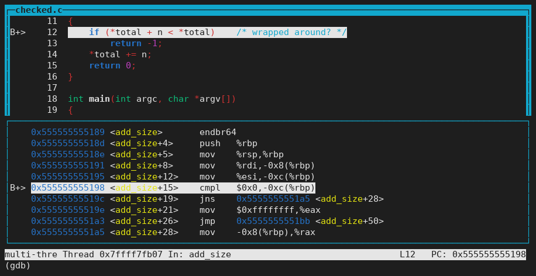
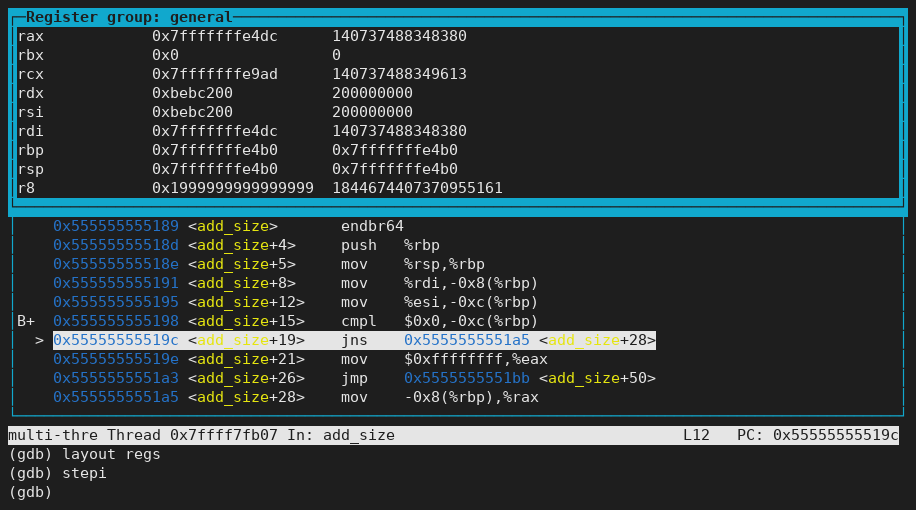
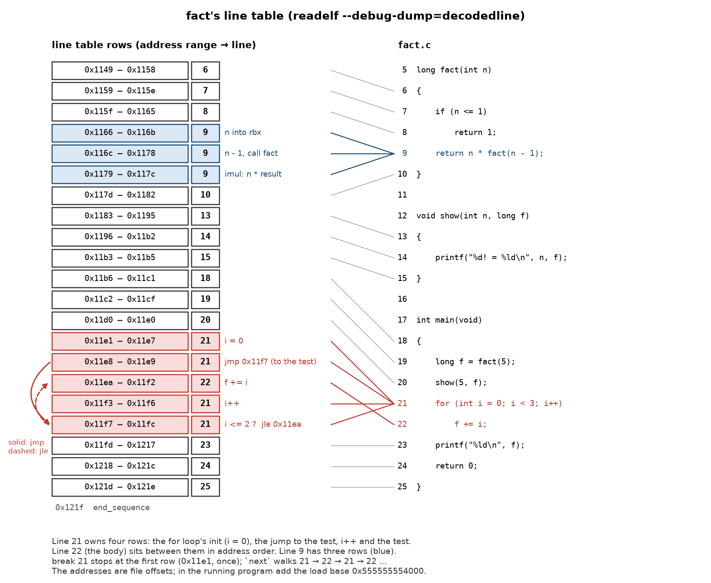

# Chapter 6 — Down to the Metal

So far every stop has been a line of C. Under each line are instructions, registers and a
calling convention, and some bugs are only visible there: a load the optimizer removed, a check
the compiler was allowed to delete, two files that disagree about which register holds a result.
This chapter reads programs at that level with `disassemble`, `x/i`, `display/i`, `stepi`,
`nexti`, `info line`, `advance`, `info registers`, `info frame` and the TUI. tdb goes the other
way: it reads the DWARF line table and becomes a source-level debugger, with `FILE:LINE` in
every stop, line breakpoints, `list`, `step`, `next`, `stepi` and `finish`.

Previous: [Chapter 5](05-crashes-and-post-mortem.md). Next: [Chapter 7](07-threads-and-processes.md).

## A program that hangs only when optimized

The examples are in `examples/ch06/`; its `Makefile` builds four programs, all with `-g`. The
first one counts as fast as it can until a timer signal says stop:

`examples/ch06/stop.c`

```c
/* stop.c - count as fast as possible for one second, then say how far we
 * got. An alarm signal ends the loop.
 *
 *     ./stop
 *     ./stop-O2
 */
#define _POSIX_C_SOURCE 200809L
#include <signal.h>
#include <stdio.h>
#include <unistd.h>

static int stop;    /* set by the signal handler */

static void on_alarm(int sig)
{
    (void)sig;
    stop = 1;
}

int main(void)
{
    struct sigaction sa = {0};
    sa.sa_handler = on_alarm;
    sigaction(SIGALRM, &sa, NULL);
    alarm(1);

    unsigned long count = 0;
    while (!stop)
        count++;
    printf("counted to %lu in one second\n", count);
    return 0;
}
```

```console
$ make
cc -std=c11 -Wall -Wextra -g -O0    stop.c   -o stop
cc -std=c11 -Wall -Wextra -g -O2 -o stop-O2 stop.c
cc -std=c11 -Wall -Wextra -g -O0    checked.c   -o checked
cc -std=c11 -Wall -Wextra -g -O0 -o report report.c mean.c
$ ./stop
counted to 4008696658 in one second
$ timeout 3 ./stop-O2; echo "exit $?"
exit 124
```

`./stop` counts to about four billion in one second (the number varies from run to run).
`./stop-O2`, the same source built with `-O2`, never finishes: `timeout` killed it after three
seconds (exit status 124). The alarm fires in both. Run the optimized one under gdb, wait a
few seconds, press Ctrl-C:

```console
$ gdb -q ./stop-O2
Reading symbols from ./stop-O2...
(gdb) run
Starting program: .../stop-O2
[Thread debugging using libthread_db enabled]
Using host libthread_db library "/lib/x86_64-linux-gnu/libthread_db.so.1".
^C
Program received signal SIGINT, Interrupt.
main () at stop.c:28
28	    while (!stop)
(gdb) bt
#0  main () at stop.c:28
(gdb) x/i $pc
=> 0x555555555119 <main+89>:	jmp    0x555555555119 <main+89>
(gdb) info line *$pc
Line 28 of "stop.c" starts at address 0x555555555119 <main+89> and ends at 0x555555555120 <main+96>.
(gdb) print stop
$1 = 1
(gdb) print count
$2 = <optimized out>
```

(The path after `Starting program:` is cut to `...` here and below; after this session the two
`libthread_db` lines are cut too.)

- gdb's default for `SIGALRM` is `nostop noprint pass` (Chapter 5), so the signal went straight
  to the handler. Ctrl-C stopped the program at line 28; `bt` shows it spinning in `main`.
- `x/i $pc` prints the instruction at the program counter: a `jmp` to its own address, which
  the CPU will run forever.
- `info line *$pc` (`*` means "an address", as in `break *ADDR`) says which line owns those
  bytes: line 28, `main+89` to `main+96`.
- `print stop` is 1: the handler set the flag, and the loop never looks at it again. `count` is
  `<optimized out>`: no register or memory location holds it here.

The source tests `stop` every time round; the machine code tested it once. Read the function.

## Reading disassemble /s

`disassemble` with no argument shows the function that contains pc; `/s` interleaves the source
lines and `/r` adds the raw bytes. (The older `/m` lists in source order; the gdb manual
deprecates it as "not useful when there is either inlined code or re-ordered code".)

```console
(gdb) disassemble /s main
Dump of assembler code for function main:
stop.c:
25	    alarm(1);
   0x0000555555555105 <+69>:	mov    $0x1,%edi
   0x000055555555510a <+74>:	call   0x5555555550a0 <alarm@plt>

26	
27	    unsigned long count = 0;
28	    while (!stop)
   0x000055555555510f <+79>:	mov    0x2eff(%rip),%eax        # 0x555555558014 <stop>
   0x0000555555555115 <+85>:	test   %eax,%eax
   0x0000555555555117 <+87>:	jne    0x555555555120 <main+96>
=> 0x0000555555555119 <+89>:	jmp    0x555555555119 <main+89>
   0x000055555555511b <+91>:	nopl   0x0(%rax,%rax,1)

/usr/include/x86_64-linux-gnu/bits/stdio2.h:
112	  return __printf_chk (__USE_FORTIFY_LEVEL - 1, __fmt, __va_arg_pack ());
   0x0000555555555120 <+96>:	xor    %edx,%edx
   0x0000555555555122 <+98>:	xor    %eax,%eax
   0x0000555555555124 <+100>:	lea    0xed9(%rip),%rsi        # 0x555555556004
   0x000055555555512b <+107>:	mov    $0x1,%edi
   0x0000555555555130 <+112>:	call   0x5555555550b0 <__printf_chk@plt>
End of assembler dump.
```

Cut here: the first 36 lines (the `sigaction` setup, lines 21 to 24) and the last ten (line
31's epilogue, with the stack canary check from Chapter 5). How to read the rest:

- Each instruction is `address <+offset>: mnemonic operands`, in address order, under the
  source line it came from. At `-O2` the labels repeat and come out of order (the cut part goes
  21, 22, 24, 21, 22, 24, 22, 23, 24) because the compiler interleaves statements. `=>` marks
  pc; a file name on its own line says where the following lines come from.
- Line 28: `mov 0x2eff(%rip),%eax` loads `stop` (gdb computes the `%rip`-relative address:
  `# 0x555555558014 <stop>`); `test` and `jne` jump to the `printf` if it is non-zero. Otherwise
  the code falls into the `jmp` to itself. The `nopl` after it is padding, never executed.
- `count++` is gone. The loop can only be left if `stop` was set at the first test, when `count`
  is still 0, so the compiler passes a constant: `xor %edx,%edx` puts 0 in `rdx`, `printf`'s
  third argument. `xor %eax,%eax` sets `al`, the number of vector registers a variadic call uses.
- `printf` became `__printf_chk`, from glibc's `bits/stdio2.h`: gcc as Ubuntu ships it defines
  `_FORTIFY_SOURCE=2` whenever it optimizes (`echo | gcc -O2 -dM -E - | grep FORTIFY` prints
  it; at `-O0` nothing), and the header then swaps in a checking `printf`.

Why may the compiler do this? To the C abstract machine nothing in the loop can change `stop`:
no function is called and `stop` is an ordinary `int`. A signal handler runs outside that
model, between any two instructions, and C11 (7.14.1.1) says that if a handler refers to a
static object other than by assigning to a `volatile sig_atomic_t` (or a lock-free atomic), the
behaviour is undefined. At `-O0` every access is kept, which is why the plain build works:

```console
$ gdb -q -batch -ex "disassemble /s main" ./stop   # -O0, lines 27-29 only
27	    unsigned long count = 0;
   0x0000000000001227 <+102>:	movq   $0x0,-0xa8(%rbp)

28	    while (!stop)
   0x0000000000001232 <+113>:	jmp    0x123c <main+123>

29	        count++;
   0x0000000000001234 <+115>:	addq   $0x1,-0xa8(%rbp)

28	    while (!stop)
   0x000000000000123c <+123>:	mov    0x2dd2(%rip),%eax        # 0x4014 <stop>
   0x0000000000001242 <+129>:	test   %eax,%eax
   0x0000000000001244 <+131>:	je     0x1234 <main+115>
```

The test at the bottom of the loop reloads `stop` every time and jumps back with `je`. The bug
was in the source all along; `-O0` just did not exploit it. The fix says what the flag is:
`volatile` means every read and write in the source must happen in the machine code, and
`sig_atomic_t` is an integer type read and written in one piece even with signals arriving.
With `static volatile sig_atomic_t stop;` at `-O2`:

```console
$ gdb -q -batch -ex "disassemble /s main" ./stop-fixed   # lines 27-29 only
27	    unsigned long count = 0;
   0x0000000000001115 <+85>:	xor    %edx,%edx

28	    while (!stop)
   0x0000000000001117 <+87>:	test   %eax,%eax
   0x0000000000001119 <+89>:	jne    0x112e <main+110>
   0x000000000000111b <+91>:	nopl   0x0(%rax,%rax,1)

29	        count++;
   0x0000000000001120 <+96>:	mov    0x2eee(%rip),%eax        # 0x4014 <stop>
   0x0000000000001126 <+102>:	add    $0x1,%rdx

28	    while (!stop)
   0x000000000000112a <+106>:	test   %eax,%eax
   0x000000000000112c <+108>:	je     0x1120 <main+96>
```

The load is inside the loop now (labelled line 29: the compiler interleaved it with `count++`),
`count` lives in `rdx`, and `je` jumps back to the load. That build prints its count and exits.
signal-safety(7) lists what else a handler may safely do.

## One instruction at a time

The next program prints the mean of four scores. It has a bug we will come back to; first use
it to walk through a call instruction by instruction.

`examples/ch06/report.c`

```c
/* report.c - print the average score.
 *
 *     ./report
 */
#include <stdio.h>

int mean(const int *v, int n);

int main(void)
{
    int scores[] = { 7, 9, 8, 10 };

    printf("mean score: %d\n", mean(scores, 4));
    return 0;
}
```

`examples/ch06/mean.c`

```c
/* mean.c - the average of n values. */

double mean(const int *v, int n)
{
    long sum = 0;

    for (int i = 0; i < n; i++)
        sum += v[i];
    return (double)sum / n;
}
```

```console
$ gdb -q ./report
Reading symbols from ./report...
(gdb) break *main
Breakpoint 1 at 0x1169: file report.c, line 10.
(gdb) run
Starting program: .../report

Breakpoint 1, main () at report.c:10
10	{
(gdb) x/3i $pc
=> 0x555555555169 <main>:	endbr64
   0x55555555516d <main+4>:	push   %rbp
   0x55555555516e <main+5>:	mov    %rsp,%rbp
(gdb) info line 13
Line 13 of "report.c" starts at address 0x5555555551a0 <main+55> and ends at 0x5555555551c7 <main+94>.
(gdb) disassemble /r 0x00005555555551a0,0x00005555555551c7
Dump of assembler code from 0x5555555551a0 to 0x5555555551c7:
   0x00005555555551a0 <main+55>:	48 8d 45 e0	lea    -0x20(%rbp),%rax
   0x00005555555551a4 <main+59>:	be 04 00 00 00	mov    $0x4,%esi
   0x00005555555551a9 <main+64>:	48 89 c7	mov    %rax,%rdi
   0x00005555555551ac <main+67>:	e8 31 00 00 00	call   0x5555555551e2 <mean>
   0x00005555555551b1 <main+72>:	89 c6	mov    %eax,%esi
   0x00005555555551b3 <main+74>:	48 8d 05 4a 0e 00 00	lea    0xe4a(%rip),%rax        # 0x555555556004
   0x00005555555551ba <main+81>:	48 89 c7	mov    %rax,%rdi
   0x00005555555551bd <main+84>:	b8 00 00 00 00	mov    $0x0,%eax
   0x00005555555551c2 <main+89>:	e8 a9 fe ff ff	call   0x555555555070 <printf@plt>
End of assembler dump.
(gdb) advance *0x00005555555551ac
0x00005555555551ac in main () at report.c:13
13	    printf("mean score: %d\n", mean(scores, 4));
(gdb) x/4dw $rdi
0x7fffffffe3f0:	7	9	8	10
(gdb) nexti
0x00005555555551b1	13	    printf("mean score: %d\n", mean(scores, 4));
(gdb) print/x $rax
$1 = 0x4021000000000000
(gdb) info frame
Stack level 0, frame at 0x7fffffffe420:
 rip = 0x5555555551b1 in main (report.c:13); saved rip = 0x7ffff7c29d90
 source language c.
 Arglist at 0x7fffffffe410, args:
 Locals at 0x7fffffffe410, Previous frame's sp is 0x7fffffffe420
 Saved registers:
  rbp at 0x7fffffffe410, rip at 0x7fffffffe418
```

- `break *main` stops at main's first instruction, before the prologue; gdb calls it line 10,
  the `{`. `break main` without the `*` stops after the prologue (next section).
- `x/3i $pc` shows three instructions from pc. `endbr64` marks a valid target for an indirect
  jump or call (Intel's control-flow enforcement) and does nothing on a CPU that does not
  enforce it. `push %rbp; mov %rsp,%rbp` is the frame-pointer prologue from Chapter 5.
- `info line 13` gives line 13's address range, `main+55` to `main+94`, and
  `disassemble /r START,END` disassembles that range with the bytes. The call to `mean` is
  `e8 31 00 00 00`: opcode `e8` ("call rel32") and a 32-bit little-endian displacement,
  0x31, counted from the end of the call, the next instruction. 0x5555555551b1 + 0x31 =
  0x5555555551e2, the address of `mean`. The call to `printf` is `e8 a9 fe ff ff`: 0xfffffea9 is
  −0x157, and 0x5555555551c7 − 0x157 = 0x555555555070. tdb's `next` will look for exactly this
  `e8` byte.
- `advance LOCATION` runs to a location with a one-shot breakpoint (or until the current
  function returns). At the call the arguments are ready: `x/4dw $rdi` shows four decimal
  words at the address in `rdi`, the array `scores`; `rsi` is 4 (`mov $0x4,%esi`).
- `nexti` executes one instruction and counts a whole call as one; `stepi` would have stopped at
  mean's first instruction. An address before the line number (`0x00005555555551b1	13`) means
  pc is in the middle of line 13, not at its start.
- `print/x $rax` is 0x4021000000000000. Remember that number.
- gdb prints AT&T syntax: source first, `%` before registers, `$` before constants, a size
  suffix where the operands do not imply one (`cmpl`). `set disassembly-flavor intel` switches
  to the Intel syntax of NASM (learn-linux-nasm): destination first, memory in brackets.
- `info frame`: "frame at 0x7fffffffe420" is the CFA, the value `rsp` had before the `call` that
  entered `main`. The return address (saved `rip`, into libc) is at CFA − 8 and the saved `rbp`
  at CFA − 16: the layout tdb's backtrace walked in Chapter 5.

## Calling conventions: where the arguments are

Every call above followed the System V x86-64 calling convention (the psABI), used by gcc and
every library on Linux x86-64:

| What | Where |
|---|---|
| integer and pointer arguments 1–6 | `rdi`, `rsi`, `rdx`, `rcx`, `r8`, `r9` |
| `float` and `double` arguments 1–8 | `xmm0`–`xmm7` |
| more arguments | on the stack, above the return address |
| integer or pointer result | `rax` (`rdx:rax` for 128-bit values) |
| `float` or `double` result | `xmm0` |
| return address | `[rsp]` at the function's first instruction |
| preserved across a call (callee-saved) | `rbx`, `rbp`, `r12`–`r15` (and `rsp`) |
| may be clobbered by a call (caller-saved) | `rax`, `rcx`, `rdx`, `rsi`, `rdi`, `r8`–`r11`, `xmm0`–`xmm15` |

At a function's first instruction this table is all you have. The next program adds sizes
given on the command line and refuses to overflow an `int`:

`examples/ch06/checked.c`

```c
/* checked.c - add up the sizes given on the command line, refusing to
 * overflow an int.
 *
 *     ./checked 2000000000 100000000 200000000
 */
#include <stdio.h>
#include <stdlib.h>

/* Add n (> 0) to *total; return -1 instead if the sum does not fit. */
int add_size(int *total, int n)
{
    if (*total + n < *total)    /* wrapped around? */
        return -1;
    *total += n;
    return 0;
}

int main(int argc, char *argv[])
{
    int total = 0;

    for (int i = 1; i < argc; i++) {
        int n = atoi(argv[i]);
        if (n <= 0)
            continue;
        if (add_size(&total, n) < 0) {
            printf("too big: stopped at argument %d\n", i);
            return 1;
        }
    }
    printf("total: %d\n", total);
    return 0;
}
```

```console
$ gdb -q ./checked
Reading symbols from ./checked...
(gdb) break *add_size if $rsi == 200000000
Breakpoint 1 at 0x1189: file checked.c, line 11.
(gdb) run 2000000000 100000000 200000000
Starting program: .../checked 2000000000 100000000 200000000

Breakpoint 1, add_size (total=0x7ffff7c43654 <__GI_atoi+20>, n=32767) at checked.c:11
11	{
(gdb) info registers rdi rsi
rdi            0x7fffffffe3bc      140737488348092
rsi            0xbebc200           200000000
(gdb) print *(int *)$rdi
$1 = 2100000000
(gdb) x/gx $rsp
0x7fffffffe398:	0x0000555555555228
(gdb) info symbol *(long *)$rsp
main + 107 in section .text of .../checked
(gdb) display/i $pc
1: x/i $pc
=> 0x555555555189 <add_size>:	endbr64
(gdb) si
0x0000555555555191	11	{
1: x/i $pc
=> 0x555555555191 <add_size+8>:	mov    %rdi,-0x8(%rbp)
(gdb) si
0x0000555555555195	11	{
1: x/i $pc
=> 0x555555555195 <add_size+12>:	mov    %esi,-0xc(%rbp)
(gdb) si
12	    if (*total + n < *total)    /* wrapped around? */
1: x/i $pc
=> 0x555555555198 <add_size+15>:	cmpl   $0x0,-0xc(%rbp)
```

(Cut: an `x/i`, a `print`, and the first two steps, through `push %rbp; mov %rsp,%rbp`.)

- `break *add_size if $rsi == 200000000` puts a condition on a register: at the first
  instruction `n` cannot be read yet, but `rsi` holds it. It stops at the third call.
- The stop line shows garbage arguments (`n=32767`): gdb reads them where the debug information
  says they live, and they are not there yet. `info registers rdi rsi` shows the real ones;
  `print *(int *)$rdi` needs the cast because a register has no C type.
- `x/gx $rsp` is the return address that `call` pushed; `info symbol` names it, `main + 107`.
- `display/i $pc` prints the next instruction after every stop, so a series of `si` (`stepi`)
  reads like a trace. `mov %rdi,-0x8(%rbp)` and `mov %esi,-0xc(%rbp)` give the arguments their
  stack homes. At line 12, gdb prints the line without an address: a new line starts there.

Where do the arguments live? Ask gdb:

```console
$ gdb -q -batch -ex 'info scope add_size' ./checked
Scope for add_size:
Symbol total is a complex DWARF expression:
     0: DW_OP_fbreg -24
, length 8.
Symbol n is a complex DWARF expression:
     0: DW_OP_fbreg -28
, length 4.
$ gdb -q -batch -ex 'info line add_size' -ex 'break add_size' ./checked
Line 11 of "checked.c" starts at address 0x1189 <add_size> and ends at 0x1198 <add_size+15>.
Breakpoint 1 at 0x1198: file checked.c, line 12.
```

`DW_OP_fbreg -28` means "28 bytes below the frame base", and gcc's frame base here is the CFA
(`DW_AT_frame_base` is `DW_OP_call_frame_cfa`). After the prologue the CFA is `rbp + 16`, so `n`
is at `-0xc(%rbp)` and `total` at `-0x8(%rbp)`: the slots the prologue fills. Before those
stores they hold leftovers. That is why `break add_size` (no `*`) skips the prologue, to 0x1198,
the start of the function's second line-table row, line 12.

## The check that compiled to nothing

```console
$ ./checked 10 20
total: 30
$ ./checked 2000000000 100000000 200000000
total: -1994967296
```

2100000000 + 200000000 = 2300000000 does not fit in an `int` (`INT_MAX` is 2147483647).
Wrapped to 32 bits it is 2300000000 − 2^32 = −1994967296, which is less than 2100000000, so
the check should have caught it, even in this `-O0` build. Continue the session at line 12
(`print *total` and `print n`, now correct, are cut):

```console
(gdb) print *total + n
$5 = -1994967296
(gdb) si
0x000055555555519c	12	    if (*total + n < *total)    /* wrapped around? */
1: x/i $pc
=> 0x55555555519c <add_size+19>:	jns    0x5555555551a5 <add_size+28>
(gdb) info registers eflags
eflags         0x206               [ PF IF ]
(gdb) si
14	    *total += n;
1: x/i $pc
=> 0x5555555551a5 <add_size+28>:	mov    -0x8(%rbp),%rax
(gdb) finish
Run till exit from #0  add_size (total=0x7fffffffe3bc, n=200000000) at checked.c:14
main (argc=4, argv=0x7fffffffe4e8) at checked.c:26
26	        if (add_size(&total, n) < 0) {
1: x/i $pc
=> 0x555555555228 <main+107>:	test   %eax,%eax
Value returned is $6 = 0
(gdb) print total
$7 = -1994967296
```

- gdb's own arithmetic wraps: `print *total + n` is −1994967296, less than `*total`.
- The program never computes that sum. Line 12 is `cmpl $0x0,-0xc(%rbp)` and `jns`: compare `n`
  with 0 and jump if not negative. `*total` is never read.
- `info registers eflags` shows no `SF` (sign flag), since `n` is positive, so `jns` jumps to
  line 14. `finish` prints the return value, 0, and `total` is now negative.

Signed overflow is undefined behaviour in C (C11 6.5), so the compiler may assume `*total + n`
does not overflow, and then `a + n < a` is true exactly when `n < 0`. gcc makes this rewrite even
at `-O0`; at `-O2` it is `test %esi,%esi` and `js`. Stepping by lines shows only 12 then 14;
stepping by instructions shows what line 12 tests.

Two options change the rules rather than the code (GCC manual, Code Gen and Instrumentation
Options):

```console
$ gcc -std=c11 -Wall -Wextra -g -O2 -o checked-O2 checked.c
$ ./checked-O2 2000000000 100000000 200000000
total: -1994967296
$ gcc -std=c11 -Wall -Wextra -g -fwrapv -o checked-wrapv checked.c
$ ./checked-wrapv 2000000000 100000000 200000000
too big: stopped at argument 3
$ gcc -std=c11 -Wall -Wextra -g -fsanitize=undefined -o checked-ubsan checked.c
$ ./checked-ubsan 2000000000 100000000 200000000
checked.c:12:16: runtime error: signed integer overflow: 200000000 + 2100000000 cannot be represented in type 'int'
too big: stopped at argument 3
```

`-fwrapv` defines signed overflow to wrap, so line 12 becomes a real addition and comparison
(`disassemble /s add_size` on that build shows `add %eax,%edx`, `cmp %eax,%edx`, `jge`).
`-fsanitize=undefined` (UBSan) reports the overflow at run time and keeps the addition, so the
check then works too. Both are workarounds; the real fix is to test before adding, without
overflowing (Exercise 1). gcc also has a builtin for it: in a scratch program,
`int over = __builtin_add_overflow(2100000000, 200000000, &r);` sets `over` to 1 and `r` to
the wrapped −1994967296. C23 standardizes the idea as `ckd_add` in `<stdckdint.h>`, which gcc
11 does not have yet ("fatal error: stdckdint.h: No such file or directory").

## When two files disagree

`./report` prints `mean score: 0`, but the mean of 7, 9, 8 and 10 is 8.5. `report.c` declares
`int mean(...)`, but `mean.c` defines `double mean(...)`. `-Wall -Wextra` said nothing: each
file was compiled alone, and the linker matches functions by name only.

```console
$ gdb -q ./report
Reading symbols from ./report...
(gdb) break mean
Breakpoint 1 at 0x11f1: file mean.c, line 5.
(gdb) run
Starting program: .../report

Breakpoint 1, mean (v=0x7fffffffe3f0, n=4) at mean.c:5
5	    long sum = 0;
(gdb) finish
Run till exit from #0  mean (v=0x7fffffffe3f0, n=4) at mean.c:5
0x00005555555551b1 in main () at report.c:13
13	    printf("mean score: %d\n", mean(scores, 4));
Value returned is $1 = 8.5
(gdb) print $xmm0
$2 = {v8_bfloat16 = {0, 0, 0, 2.516, 0, 0, 0, 0}, v8_half = {0, 0, 0, 2.0645, 0, 0, 0, 0}, v4_float = {0, 2.515625, 0, 0}, v2_double = {8.5, 0}, v16_int8 = {0, 0, 0, 0, 0, 0, 33, 64, 0, 0, 0, 0, 0, 0, 0, 0}, v8_int16 = {0, 0, 0, 16417, 0, 0, 0, 0}, v4_int32 = {0, 1075904512, 0, 0}, v2_int64 = {4620974692658839552, 0}, uint128 = 4620974692658839552}
(gdb) print $xmm0.v2_double[0]
$3 = 8.5
(gdb) print/f $rax
$4 = 8.5
(gdb) ptype mean
type = double (const int *, int)
(gdb) delete
Delete all breakpoints? (y or n) y
(gdb) print mean(scores, 4)
$5 = 8.5
(gdb) next
mean score: 0
14	    return 0;
```

- `finish` prints 8.5: gdb takes the return type from mean.c's debug information and reads
  `xmm0`, where the ABI returns a `double`. `print $xmm0` shows the 128-bit register as a union.
- `rax` held 0x4021000000000000 (seen with `nexti` above), the bits of the `double` 8.5: sign 0,
  exponent field 0x402 (1026 − 1023 = 3, so 2^3), fraction 1/16, and 8 × 1.0625 = 8.5.
  `print/f $rax` reinterprets the bits. They are in `rax` because this `-O0` code passes the
  result through `rax` on its way to `xmm0`: mean's last instructions are
  `movq %xmm0,%rax`, `movq %rax,%xmm0`, `pop %rbp`, `ret`.
- main's next instruction is `mov %eax,%esi` (see the `disassemble /r` above): believing `mean`
  returned an `int`, `main` passes `eax`, the low 32 bits of `rax` (0), to `printf`.
- `ptype mean` shows the real type; `print mean(scores, 4)` calls the function in the program
  with it. `next` prints the wrong line.

The fix is one header, `mean.h`, included by both files, so the compiler sees the declaration and
the definition together. Here `mean2.c` is `mean.c` with `#include "mean.h"` added, and `mean.h`
still says `int` (caret lines cut):

```console
$ gcc -std=c11 -Wall -Wextra -c mean2.c
mean2.c:4:8: error: conflicting types for ‘mean’; have ‘double(const int *, int)’
In file included from mean2.c:2:
mean.h:1:5: note: previous declaration of ‘mean’ with type ‘int(const int *, int)’
```

Link-time optimization also catches it, because the compiler sees both files at once:
`gcc -std=c11 -Wall -Wextra -flto -O2 -o report-lto report.c mean.c` warns "type of ‘mean’
does not match original declaration [-Wlto-type-mismatch]", noting "return value type mismatch".

## The TUI

gdb has a full-screen text interface. `layout split` shows source and disassembly above the
command line; `layout regs` shows registers and disassembly. Here is `checked` at the third stop
of `break 12`:



`B+>` marks the line and the instruction: `B` a breakpoint that has been hit, `+` enabled, `>`
the current position. After `layout regs` and one `stepi`:



The register window shows `rsi` = 0xbebc200 (200000000), and `>` has moved to `jns`. The stack
addresses differ slightly from the transcripts: these screens come from a separate terminal
session whose environment moves the stack. gdb itself truncates the status line.

| Command or key | Effect |
|---|---|
| `layout src`, `layout asm`, `layout split`, `layout regs` | choose the windows |
| `tui disable`, or C-x a | back to the plain command line (C-x a toggles) |
| C-x 2 | switch to the next layout with two windows |
| `focus cmd`, `focus src`, `focus asm` | which window the arrow keys scroll |
| C-l, or `refresh` | redraw after the program's output garbled the screen |

While the source window has the focus, the arrow keys scroll it instead of recalling commands.
The TUI is interactive, so the transcripts in this chapter use the plain command line.

## How the line table works

Every stop above was printed as a line of C, and `break 12` became an address. Both use the
line table that `-g` puts in the `.debug_line` section. Here it is for tdb's new test program
`fact` (`project/ch06/targets/fact.c`, listed in the tdb section below):

```console
$ readelf --debug-dump=decodedline build/targets/fact
fact.c:
File name                            Line number    Starting address    View    Stmt
fact.c                                         6              0x1149               x
fact.c                                         7              0x1159               x
fact.c                                         8              0x115f               x
fact.c                                         9              0x1166               x
fact.c                                         9              0x116c               x
fact.c                                         9              0x1179               x
fact.c                                        10              0x117d               x
fact.c                                        13              0x1183               x
fact.c                                        14              0x1196               x
fact.c                                        15              0x11b3               x
fact.c                                        18              0x11b6               x
fact.c                                        19              0x11c2               x
fact.c                                        20              0x11d0               x
fact.c                                        21              0x11e1               x
fact.c                                        21              0x11e8               x
fact.c                                        22              0x11ea               x
fact.c                                        21              0x11f3               x
fact.c                                        21              0x11f7               x
fact.c                                        23              0x11fd               x
fact.c                                        24              0x1218               x
fact.c                                        25              0x121d               x
fact.c                                         -              0x121f
```

Each row says: from this address until the next row, the code belongs to this line. The last
row (`-`) marks the end. `Stmt` `x` means `is_stmt`: the row starts a statement, a good place to
stop. Addresses are file offsets, as `nm` shows them; the running program adds its load address
(0x555555554000 under gdb).



A line can own several rows. Line 9 has three: loading `n`, the recursive call, and the
multiplication after it returns. The `for` on line 21 has four: `i = 0`, a jump to the test,
`i++` and the test, with line 22 between them. `break 21` uses the first row only, so it is hit
once, while `next` from line 22 goes back to 21 each time round:

```console
$ gdb -q -batch -ex 'break 21' -ex 'info line 22' build/targets/fact
Breakpoint 1 at 0x11e1: file targets/fact.c, line 21.
Line 22 of "targets/fact.c" starts at address 0x11ea <main+52> and ends at 0x11f3 <main+61>.
```

The section does not store the table, which would be large. It stores a program for a small
state machine (DWARF 5, section 6.2) whose registers are the columns of a row: address, file,
line, column, is_stmt and a few more. Each instruction changes registers; some append a row:

- **Special opcodes**, one byte each: advance the address and the line together, then append a
  row. Most rows cost one byte.
- **Standard opcodes** (1 to `opcode_base` − 1): `copy` (append a row), `advance_pc`,
  `advance_line`, `set_file`, `set_column`, `negate_stmt`, `const_add_pc` and a few more, with
  LEB128 arguments (variable-length integers: 7 bits per byte, the top bit set on every byte
  but the last).
- **Extended opcodes**: a 0 byte, a length, then the opcode: `end_sequence` (append the end row
  and reset the registers), `set_address`, `set_discriminator`.

The unit's header holds the parameters (four lines cut):

```console
$ readelf --debug-dump=rawline build/targets/fact | sed -n '/DWARF Version/,/Opcode Base/p'
  DWARF Version:               5
  Minimum Instruction Length:  1
  Initial value of 'is_stmt':  1
  Line Base:                   -5
  Line Range:                  14
  Opcode Base:                 13
```

and `rawline` prints the program one instruction at a time; `-x` dumps the bytes:

```console
$ readelf --debug-dump=rawline build/targets/fact | grep -A8 'Line Number Statements'
 Line Number Statements:
  [0x00000043]  Set column to 1
  [0x00000045]  Extended opcode 2: set Address to 0x1149
  [0x00000050]  Special opcode 10: advance Address by 0 to 0x1149 and Line by 5 to 6
  [0x00000051]  Set column to 8
  [0x00000053]  Special opcode 230: advance Address by 16 to 0x1159 and Line by 1 to 7
  [0x00000054]  Set column to 16
  [0x00000056]  Special opcode 90: advance Address by 6 to 0x115f and Line by 1 to 8
  [0x00000057]  Set column to 14
$ readelf -x .debug_line build/targets/fact | sed -n 7,8p
  0x00000040 00000205 01000902 49110000 00000000 ........I.......
  0x00000050 170508f3 05106705 0e750510 66050ec8 ......g..u..f...
```

Decode the first row by hand. At offset 0x43, `05 01` is standard opcode 5, `set_column`, with
argument 1. At 0x45, `00 09 02` starts an extended opcode of 9 bytes, number 2 (`set_address`),
followed by the 8-byte address `49 11 00 00 00 00 00 00`: 0x1149. At 0x50 comes `17`, 23, a
special opcode (23 ≥ `opcode_base` 13). readelf numbers special opcodes from `opcode_base`, so
it prints 23 − 13 = 10. The rule, with that adjusted value `a`:

```
address += (a / line_range) * min_inst_length      10 / 14 = 0  ->  0x1149
line    += line_base + a % line_range              -5 + 10 = 5  ->  1 + 5 = 6
```

The line register starts at 1, so this is the row "line 6 at 0x1149". After `05 08`
(`set_column 8`), `f3` is 243, adjusted 230: the address advances by 230 / 14 = 16 to 0x1159
and the line by −5 + 230 % 14 = 1, to 7. With these parameters one byte moves the line by −5 to
+8 and the address by up to 17 bytes; `const_add_pc` ("Advance PC by constant 17") adds the
address step of opcode 255 for longer jumps.

binutils' `addr2line` answers "which line is this address" from the same table:

```console
$ addr2line -s -e build/targets/fact 0x1179 0x117d
fact.c:9
fact.c:10
$ addr2line -s -f -e report 0x11c7 0x11c6
main
report.c:14
main
report.c:13
```

The second call shows a trap. In `report`, 0x11c7 is the return address of the `printf` call on
line 13, and already the first instruction of line 14. A backtrace must look up the return
address minus 1, which is inside the `call`.

## tdb, step 6: from addresses to lines

The snapshot is `project/ch06/`. New: `src/lines.c` (the DWARF 5 line table), `src/source.c`
(printing source lines), `src/step.c` (`step`, `next`, `finish`), the target `targets/fact.c`
and `tests/test_lines.c`. Changed: `elf.c` (`elf_section` finds a section by name),
`breakpoint.c` (internal breakpoints, and breakpoints sharing an address), `run.c` (`stepi`),
`frames.c` (the return address of frame 0) and `tdb.c` (the commands, and lines in every stop).
The program the tdb sessions use:

`project/ch06/targets/fact.c`

```c
/* fact.c - a recursive function, a function that returns nothing, and a
 * loop. A target for step, next and finish. */
#include <stdio.h>

long fact(int n)
{
    if (n <= 1)
        return 1;
    return n * fact(n - 1);
}

void show(int n, long f)
{
    printf("%d! = %ld\n", n, f);
}

int main(void)
{
    long f = fact(5);
    show(5, f);
    for (int i = 0; i < 3; i++)
        f += i;
    printf("%ld\n", f);
    return 0;
}
```

**Reading the table.** `lines_load` finds `.debug_line` (and the string sections it refers
to) with `elf_section` and reads one unit after another: a header (a unit that is not version 5
is skipped and counted, and tdb prints "Skipped 1 line table unit that is not DWARF 5 (compile
with -gdwarf-5)."), a directory table, a file table, then the line program. `report` has two
units, one per `.c` file. The state machine is a loop over the bytes (shortened):

```c
    while (c->p < c->end && !c->bad) {
        unsigned op = (unsigned)fixed(c, 1);
        if (op >= h->opcode_base) {
            /* A special opcode: one byte that advances the address and the
             * line together, then appends a row. */
            unsigned adjusted = op - h->opcode_base;
            r.addr += (adjusted / h->line_range) * h->min_inst_length;
            r.line += h->line_base + (int)(adjusted % h->line_range);
            if (!add_row(&r))
                return false;
            continue;
        }
        switch (op) {
        case 0: {
            /* An extended opcode: its length, then the opcode itself. */
            uint64_t len = uleb(c);
            if (len == 0 || len > (uint64_t)(c->end - c->p))
                return false;
            const unsigned char *next = c->p + len;
            unsigned sub = (unsigned)fixed(c, 1);
            if (sub == DW_LNE_end_sequence) {
                r.end_seq = true;
                if (!add_row(&r))
                    return false;
                RESET();
            } else if (sub == DW_LNE_set_address) {
                r.addr = fixed(c, 8);
            }
            /* DW_LNE_set_discriminator and others: nothing we keep. */
            c->p = next;
            break;
        }
        /* ... copy, advance_pc, advance_line, set_file, set_column,
         * negate_stmt and const_add_pc: a few lines each ... */
        }
    }
```

The cursor is bounds-checked (a corrupt section sets `c->bad`), and an unknown standard opcode
is skipped using the header's `standard_opcode_lengths`.

**Looking up.** Four functions answer the debugger's questions:

- `line_at(addr)`: the row that covers an address (the last row at or below it, in a sequence
  whose end row is above it), or NULL.
- `line_is_start(addr)`: does an `is_stmt` row start exactly here? If not, a stop is shown with
  the address first.
- `line_find(file, line, ...)`: for `break FILE:LINE`, the lowest address of the nearest line at
  or after the wanted one that has code (`break 21` picks 0x11e1; a comment moves down).
- `line_after_prologue(func, size)`: for `break FUNC`, the lowest `is_stmt` row address above
  the entry, as gdb chose for `add_size` (0x1198).

That is a behaviour change: `break FUNC` now stops after the prologue, like gdb, and earlier
chapters' tests that need the very first instruction now use `break *FUNC`.

**Stepping.** The CPU executes one instruction at a time, so `step` is a loop: single-step,
look the new pc up, stop if a new line starts there. `step_line` in `src/step.c` (`over` is true
for `next`) adds two things. First, calls. Before each `stepi` it reads the instruction (with
`bp_read_code`, which puts back the bytes under breakpoints) and asks `is_call`: `e8`, or `ff`
with 2 or 3 in the middle bits of the next byte (an indirect call), after optional prefixes.
After a call, pc is at the callee's first instruction and the return address is at `[rsp]`:

```c
    for (;;) {
        bool call = bp_read_code(p, pc, code, sizeof code) == 0 && is_call(code, sizeof code);
        if (run_stepi(p, st) < 0)
            return -1;
        if (st->why != STOP_STEP)
            return 0;
        if (where_now(p, &pc, &sp) < 0)
            return -1;

        if (call) {
            /* At the first instruction of the called function; the return
             * address is at [rsp]. */
            if (!over && line_at(pc - base) != NULL)
                return skip_prologue(p, st, pc);
            uint64_t ret;
            if (proc_peek(p, sp, &ret) < 0)
                return -1;
            int r = return_to(p, st, ret, sp + 8);
            if (r != 0)
                return r < 0 ? -1 : 0;
            pc = ret;       /* back after the call: a new line may start here */
        }

        const struct line_row *row = line_at(pc - base);
        if (row == NULL)
            return 0;       /* returned into code without lines (main's caller) */
        if (line_is_start(pc - base) && (row->line != line || row->file != file))
            return 0;
    }
```

`step` goes into a callee that has line information and steps through its prologue to the first
line of the body (`skip_prologue`). `next`, and `step` into code without lines (`printf` through
the PLT), run the callee to its return. Second, the stop rule: stop where an `is_stmt` row starts
a *different* line, or where pc leaves code with lines (returning from `main` into libc).
Returning into the middle of a line, as after `fact(n - 1)` returns into line 9, is not a new
line, so the loop goes on.

Running to a return address is `return_to`: an internal breakpoint there (negative ids, not
shown by `info breakpoints`), then continue. In `fact` every level returns to the same address,
0x1179 in the file (0x555555555179 at run time), so a `finish` from `fact(4)` must stop only
when `rsp` is back to the value it had in the caller (`sp + 8` in the code above). When the
internal breakpoint is hit, `return_to` compares and, if the frame is a deeper one, continues:
`if (now_sp != sp) continue;`. `finish` itself is `step_finish`: `frame_return` finds frame 0's
return address and its stack slot (with Chapter 5's prologue analysis), then calls `return_to`.

Internal breakpoints exposed an old bug. `next` may put its breakpoint on an address that
already has a user breakpoint. The second insert read the `0xCC` already there and saved it as
the "original" byte, so removing both left an `int3` in the code forever. `bp_insert` now copies
the saved byte from the breakpoint already at that address, and `bp_remove` leaves the `0xCC`
while another breakpoint needs it.

**Showing a location.** `show_location` prints gdb's two forms: the frame line
`fact () at targets/fact.c:7` (with `0x... in` in front when pc is mid-line) and the source line;
a step within one function prints only the latter. In `bt`, frames above #0 look up the return
address minus 1.

Build, test and run it:

```console
$ cd project/ch06
$ make test
...
unit: 22 passed, 0 failed
...
itest: 52 passed, 0 failed
$ build/tdb build/targets/fact
Reading symbols from build/targets/fact: 20 symbols, 22 line table rows.
(tdb) break main
Breakpoint 1 at 0x11c2: file targets/fact.c, line 19.
(tdb) break fact.c:9
Breakpoint 2 at 0x1166: file targets/fact.c, line 9.
(tdb) info breakpoints
Num  Type        Disp  Address  In memory           Hits  What
1    breakpoint  keep  0x11c2   (not running)       0     in main at targets/fact.c:19
2    breakpoint  keep  0x1166   (not running)       0     in fact at targets/fact.c:9
(tdb) run
Started process 729436: build/targets/fact
Breakpoint 1, main () at targets/fact.c:19
19	    long f = fact(5);
(tdb) step
fact () at targets/fact.c:7
7	    if (n <= 1)
(tdb) stepi
0x000055555555515d	7	    if (n <= 1)
(tdb) stepi
Breakpoint 2, fact () at targets/fact.c:9
9	    return n * fact(n - 1);
(tdb) next
Breakpoint 2, fact () at targets/fact.c:9
9	    return n * fact(n - 1);
(tdb) bt
#0  fact () at targets/fact.c:9
#1  0x0000555555555179 in fact () at targets/fact.c:9
#2  0x00005555555551cc in main () at targets/fact.c:19
(tdb) delete
(tdb) finish
Run till exit from #0  fact () at targets/fact.c:9
fact () at targets/fact.c:9
9	    return n * fact(n - 1);
Value returned in rax: 24 (0x18)
(tdb) next
10	}
(tdb) step
main () at targets/fact.c:20
20	    show(5, f);
(tdb) step
show () at targets/fact.c:14
14	    printf("%d! = %ld\n", n, f);
(tdb) step
5! = 120
15	}
(tdb) quit
```

- `list` (cut here) prints ten source lines, as gdb does; `info breakpoints` shows lines.
- `step` from line 19 enters `fact` at line 7, after the prologue. The second `stepi` lands on
  breakpoint 2 and reports it as a hit, as gdb does.
- `next` on line 9 steps over `fact(4)`, which hits breakpoint 2: a breakpoint inside the
  stepped-over call wins.
- `finish` from `fact(4)` runs the recursion below it and stops in `fact(5)` at 0x1179, the start
  of line 9's third row, so no address is printed. `rax` is 24 = 4!.
- `step` on line 14 does not enter `printf` (libc has no lines here): `5! = 120`, then line 15.

gdb, given the same commands on a scratch copy of `fact` built the same way, stops at the same
lines and addresses. It also prints arguments and typed values (`#1  0x0000555555555179 in fact
(n=5) at targets/fact.c:9`, `Value returned is $1 = 24`), which need `.debug_info`, the other
half of DWARF, which tdb does not read. And gdb's last `step` enters `printf`, because it has
line information for libc (the glibc debug info from Chapter 1).

The missing types matter for `finish` in `report`:

```console
$ cd ../../examples/ch06
$ ../../project/ch06/build/tdb ./report
Reading symbols from ./report: 19 symbols, 19 line table rows.
(tdb) break mean
Breakpoint 1 at 0x11f1: file mean.c, line 5.
(tdb) run
Started process 727325: ./report
Breakpoint 1, mean () at mean.c:5
5	    long sum = 0;
(tdb) finish
Run till exit from #0  mean () at mean.c:5
0x00005555555551b1 in main () at report.c:13
13	    printf("mean score: %d\n", mean(scores, 4));
Value returned in rax: 4620974692658839552 (0x4021000000000000)
(tdb) stepi
0x00005555555551b3	13	    printf("mean score: %d\n", mean(scores, 4));
(tdb) reg rsi
rsi = 0x0 (0)
```

tdb prints `rax`, because it cannot know the type. It shows the junk that `main` really uses:
`stepi` executes `mov %eax,%esi`, and `rsi` is 0, the value printed. gdb printed 8.5, the value
`mean` meant. Both are true. Exercise 4 adds `xmm0`.

## Common mistakes

- **Running to a return address without checking `rsp`.** A scratch tdb without the test, after
  `break fact`, `run`, `continue`, `delete`, `finish`, stopped when `fact(1)` returned into
  `fact(2)`: "Value returned in rax: 1 (0x1)", three `fact` frames in `bt`. Correct: 24.
- **Continuing the step loop after `next` returns from a call.** A scratch tdb that did so
  skipped a line: on the `deep` target (Chapter 5), `next` at line 29 went to line 31, because
  line 30 starts exactly at `printf`'s return address. Check the line there first.
- **Reading arguments at a function's first instruction** (`n=32767` at `break *add_size`). Use
  the registers there, or `break add_size`.
- **An overflow check that overflows** (`a + n < a` for signed `a`), or **a signal flag that is
  not `volatile sig_atomic_t`**. Both look fine in the source; read the instructions.
- **Stopping inside code without lines.** `step` into `printf@plt` must run to the return. gdb
  does the same when you `stepi` into a PLT stub and then `step` (here on `deep`): "Single
  stepping until exit from function strlen@plt, which has no line number information."

## In the wild

- **DWARF.** The DWARF FAQ says the format was developed at Bell Labs for the System V debugger
  `sdb`, alongside ELF, which is where the pun comes from. Brian Russell, its original
  developer, named it "Debugging With Attributed Record Formats". The PLSIG of UNIX International
  standardized it as DWARF 1. The specifications are dated 6 October 1992 (1.1.0), 27 July 1993
  (2.0.0), 10 June 2010 (4) and 13 February 2017 (5).
- **The line program.** The same FAQ calls the line-number design "effectively a
  fourth-generation line table", all generations designed by one person; earlier ones were used
  by MIPS COFF and (with a question mark in the FAQ) Borland.
- **DWARF 5 by default.** GCC 11's release notes say it defaults to DWARF version 5 on most
  targets, which "can produce up to 25% more compact debug information", and list GDB 8.0 or
  higher among the consumers that read it. That is why tdb reads version 5 only.
- **The TUI.** The gdb manual's Contributors section credits HP with the "Text User Interface
  (nee Terminal User Interface)", among other HP contributions.

## Summary

- `x/i $pc`, `display/i $pc`, `stepi` and `nexti` work one instruction at a time; `disassemble
  /s` shows each instruction's line, `/r` its bytes. `break *ADDR` and `info line *ADDR` take
  addresses; `break FUNC` stops after the prologue, where the arguments are in place.
- System V x86-64: arguments in `rdi`, `rsi`, `rdx`, `rcx`, `r8`, `r9` (`xmm0`–`xmm7` for
  floating point); result in `rax` or `xmm0`; return address at `[rsp]` on entry.
- Optimized code can drop loads (use `volatile sig_atomic_t` for signal flags) and checks that
  rely on undefined behaviour (signed overflow), even at `-O0`. Read the instructions to see.
- A declaration that disagrees with the definition goes unnoticed unless both see one header.
- The DWARF line table is a byte program for a state machine; tdb runs it and builds `list`,
  line breakpoints, `step`, `next` and `finish` on top.

## Exercises

1. Fix `checked.c` without changing the compiler flags, so that
   `./checked 2000000000 100000000 200000000` refuses at argument 3 at `-O0` and `-O2`. Then
   read the `-O2` code of `add_size` with `disassemble /s`.

<details><summary>Solution</summary>

Test the room left before adding, which cannot overflow because `*total` is never negative
here: line 12 becomes `if (n > INT_MAX - *total)   /* would not fit? */`, and `<limits.h>` is
included (so the `if` moves to line 13). Built as `checked-fixed-O0` and `checked-fixed-O2`:

```console
$ ./checked-fixed-O0 2000000000 100000000 200000000
too big: stopped at argument 3
$ ./checked-fixed-O2 2000000000 100000000 200000000
too big: stopped at argument 3
$ gdb -q -batch -ex 'disassemble /s add_size' ./checked-fixed-O2
13	    if (n > INT_MAX - *total)   /* would not fit? */
   0x0000000000001224 <+4>:	mov    (%rdi),%eax
   0x0000000000001226 <+6>:	mov    $0x7fffffff,%edx
   0x000000000000122b <+11>:	sub    %eax,%edx
   0x000000000000122d <+13>:	cmp    %esi,%edx
   0x000000000000122f <+15>:	jl     0x1240 <add_size+32>
```

(The listing is cut to line 13.) The code loads `*total`, computes `INT_MAX - *total`
(`mov $0x7fffffff,%edx`, `sub %eax,%edx`), compares it with `n` and jumps to the `return -1`
with `jl`. Only then does it add.

</details>

2. Add `until` (`u`) to tdb. Like `next`, but when the step ends at or before the address where
   it started, in the same frame (the jump back of a loop), it keeps going. On `fact`,
   `tbreak 22`, `run`, `next`, `next`, `until`, `until` should end on line 23, as in gdb.

<details><summary>Solution</summary>

In `tdb.c`, dispatch `until`/`u` to `cmd_step('u')`. `cmd_step` has already read the registers
into `regs` and makes the first step with `step_line(&proc, &st, how != 's')`, which treats
`'u'` as `next`. After it, repeat while pc is at or before the start and `rsp` is unchanged:

```c
    int r = how == 'i' ? run_stepi(&proc, &st) : step_line(&proc, &st, how != 's');
    /* until: a line at or before where we started, in the same frame, is
     * the loop jumping back: keep going. */
    uint64_t start_pc = regs.rip, start_sp = regs.rsp;
    while (how == 'u' && r == 0 && st.why == STOP_STEP && proc_get_regs(&proc, &regs) == 0 &&
           regs.rip <= start_pc && regs.rsp == start_sp)
        r = step_line(&proc, &st, true);
```

After `tbreak 22`, `run`, `next` and `next`:

```console
(tdb) until
21	    for (int i = 0; i < 3; i++)
(tdb) until
23	    printf("%ld\n", f);
```

gdb gives the same lines. The second `until` starts on line 21 at the `i++` row; every step that
ends at or before that address in the same frame is the loop going round, so it runs to line 23.

</details>

3. Add `info line LOC` to tdb, printing gdb's sentence: `Line 21 of "targets/fact.c" starts at
   address 0x11e1 <main+43> and ends at 0x11e8 <main+50>.` For a function, report the row of its
   first instruction, as gdb does.

<details><summary>Solution</summary>

A new `cmd_info_line(arg)` in `tdb.c` first turns `arg` into a file offset `a` as `break` does
(`parse_file_line` and `line_find`, `sym_by_name`, or `parse_location` minus the load base).
The row's end is the next row's address, `row[1].addr`; the end row of each sequence makes that
safe:

```c
    const struct line_row *row = line_at(a);
    if (row == NULL) {
        printf("No line number information available for address 0x%" PRIx64 "\n", a + base());
        return;
    }
    uint64_t start = row->addr + base(), end = row[1].addr + base();
    printf("Line %d of \"%s\" starts at address 0x%" PRIx64 " <%s> and ends at 0x%" PRIx64
           " <%s>.\n", row->line, line_file_name(row->file), start,
           sym_describe(row->addr, from, sizeof from) ? from : "??", end,
           sym_describe(row[1].addr, to, sizeof to) ? to : "??");
}
```

```console
$ build/tdb build/targets/fact
(tdb) info line 21
Line 21 of "targets/fact.c" starts at address 0x11e1 <main+43> and ends at 0x11e8 <main+50>.
(tdb) info line fact
Line 6 of "targets/fact.c" starts at address 0x1149 <fact> and ends at 0x1159 <fact+16>.
```

Once the program runs, the addresses include the load address, as in gdb.

</details>

4. Make tdb's `finish` also print `xmm0` as a `double`. Why can tdb still not decide which of the
   two values is the answer?

<details><summary>Solution</summary>

`PTRACE_GETFPREGS` fills a `struct user_fpregs_struct` (from `<sys/user.h>`); its `xmm_space`
holds the sixteen `xmm` registers, 16 bytes each, and the low 8 bytes of `xmm0` are the
`double`. At the end of `cmd_finish` (with `<sys/ptrace.h>` and `<sys/user.h>` included):

```c
    struct user_fpregs_struct fp;
    double d;
    if (st.why == STOP_STEP && ptrace(PTRACE_GETFPREGS, proc.pid, 0, &fp) == 0) {
        memcpy(&d, fp.xmm_space, sizeof d);     /* the low 8 bytes of xmm0 */
        printf("Value returned in xmm0 as double: %g\n", d);
    }
```

The same session as the `report` one above, from `examples/ch06`, now ends:

```console
(tdb) finish
Run till exit from #0  mean () at mean.c:5
0x00005555555551b1 in main () at report.c:13
13	    printf("mean score: %d\n", mean(scores, 4));
Value returned in rax: 4620974692658839552 (0x4021000000000000)
Value returned in xmm0 as double: 8.5
```

Which register holds the result depends on the function's return type: `int` and pointers in
`rax`, `double` in `xmm0`, `void` in neither. That type is in `.debug_info` (the
`DW_TAG_subprogram` entry of `mean` and its `DW_AT_type`), which tdb does not read. gdb does,
which is why it printed only `8.5`.

</details>

Sources for this chapter: [REFERENCES.md](REFERENCES.md#chapter-6--down-to-the-metal)
