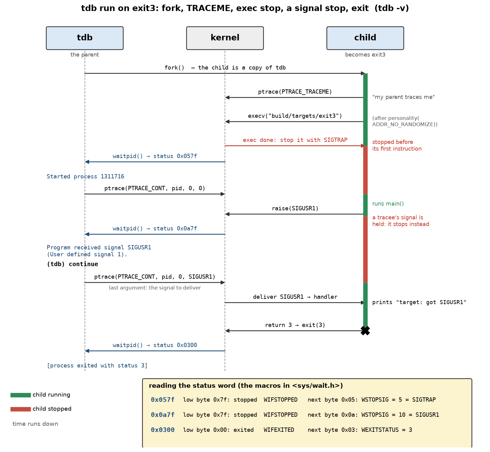
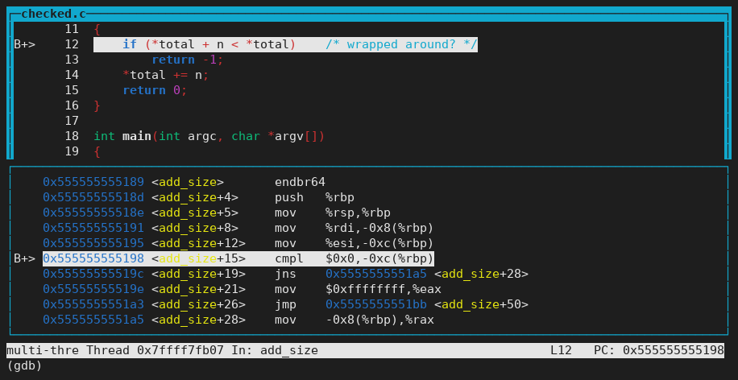
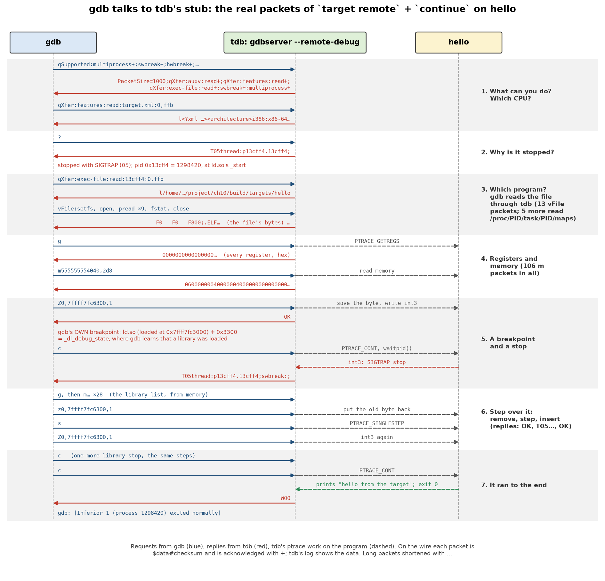

# Learn GDB by Building a Debugger

A debugger stops a running program and lets you look inside it: its variables, its memory, its
registers, its threads, the chain of calls that led to a crash. On Linux the debugger is **gdb**,
and almost everything it does rests on one system call, `ptrace(2)`, which lets one process
control another.

This course teaches gdb 12.1 on Linux x86-64 by debugging real bugs in small C programs: a
wrong average, a ledger that pays too much, a value nobody assigns, a crash inside the C library,
a hang that appears only with `-O2`, a lost update between threads, a hash table that loses
things, a balance that is wrong at the end, a crash on a "device" with no debug info. Next to
gdb you build **tdb**, a small debugger of your own in C, on `ptrace`. Each chapter adds the
mechanism behind the gdb feature it teaches: `int3` breakpoints, the ELF symbol table, the debug
registers, signals and backtraces, the DWARF line table, threads, a command language, record and
replay, and finally a gdbserver that gdb itself can connect to.

The course borrows from two classics. As in *Go by Example*, every idea comes with a small,
complete example and the output it really printed. As in *The Rust Programming Language*, the
chapters tell a story: each one explains *why* things work the way they do and shows the
mistakes and confusing messages you are likely to meet. And one project, tdb, grows chapter by
chapter, from a program that starts a child and reports how it stopped to a debugger of about 8500 lines.

By the end you can:

- build programs for debugging (`-g`, `-O0`, `-Og`, `-O2`) and know what each level hides;
- stop a program where it matters: breakpoints on functions, lines and addresses, conditions,
  ignore counts, `tbreak`, `until`, `advance`, `dprintf` and breakpoint commands;
- read data with `print`, `ptype`, `x`, artificial arrays, value history and registers, and
  change it while the program runs;
- find who writes a variable with hardware watchpoints, and watch system calls with
  `catch syscall` and `strace`;
- explain a crash from a backtrace, `$_siginfo`, a core file or AddressSanitizer, attach to a
  running process, and decide which signals gdb stops for;
- debug optimized code at the instruction level with `disassemble /s`, `stepi` and the TUI;
- debug threads and forks: all-stop, `thread apply all bt`, races found with watchpoints and
  ThreadSanitizer, `follow-fork-mode`;
- automate gdb with `define`, breakpoint commands, batch runs, `.gdbinit` and Python pretty
  printers, commands, functions and breakpoints;
- run a program backwards with `record full` and the reverse commands, and go back to
  checkpoints;
- debug a program remotely through gdbserver, with debug info that lives only on your machine;
- explain how all of it works, because tdb does each of these things (at a small scale) with
  `ptrace`, `waitpid` and the x86-64 registers.

## Prerequisite

This course builds on **[learn-c](https://github.com/sipak-gh/learn-c)**: C11, pointers, structs,
the heap, Makefiles, multi-file programs, and the gdb basics of learn-c's Chapter 10 (`run`,
`bt`, `print`, `next`, `step`, `finish`, `watch`, `display`). The chapters recap those briefly
and go much further. No assembly is assumed: the chapters introduce the x86-64 registers and
instructions as they need them.

## Requirements

Every console output in the course comes from these versions, on Ubuntu 22.04:

| Tool | Version | Used for |
|------|---------|----------|
| Linux x86-64 | any modern kernel | everything: tdb uses Linux's `ptrace` and x86-64 registers directly |
| gcc | 11.4 | building the examples and tdb |
| GNU make | 4.3 | every build |
| GNU binutils | 2.38 | `readelf`, `objdump`, `objcopy` (Chapters 3, 6 and 10) |
| gdb | 12.1 | the debugger the course teaches (with its embedded Python 3.10, Chapter 8) |
| gdbserver | 12.1 | remote debugging (Chapter 10) |
| strace | 5.16 | tracing system calls (Chapters 1 and 4) |
| glibc debug info (`libc6-dbg`) | 2.35 | optional: source lines in backtraces through the C library |
| GNU readline (`libreadline-dev`) | 8.1 | optional: line editing in tdb from Chapter 8 (`make READLINE=no` builds without it) |

On Ubuntu 22.04:

```console
$ sudo apt install build-essential gdb gdbserver strace libc6-dbg libreadline-dev
```

If gdb asks `Enable debuginfod for this session? (y or [n])`, answer `n` (or put
`set debuginfod enabled off` in `~/.gdbinit`): the transcripts were made without it. Attaching
to a running process (Chapters 5, 7 and 10) depends on `/proc/sys/kernel/yama/ptrace_scope`;
Chapter 5 explains the setting.

## How to use this course

- **Read in order.** Each chapter uses only what earlier chapters (and learn-c) taught.
- **Type the commands.** Shell commands start with `$`, gdb commands with `(gdb)`, tdb commands
  with `(tdb)`, and each is followed by its real output. Addresses and process IDs on your
  machine will differ.
- **Examples:** `examples/chNN/` holds the buggy programs of chapter NN, with a `Makefile`. `make`
  builds them next to their sources; `make clean` removes them.
- **Project snapshots:** `project/chNN/` is tdb as it stands at the end of chapter NN, with its
  own `README.md` and `Makefile`. `make` builds it into `project/chNN/build/`, and `make test`
  runs its unit tests and integration tests (tdb driving small target programs). If you get
  stuck, compare your code with the snapshot.
- **Figures:** `images/` holds every figure of the course.
- **Exercises** end each chapter. Their solutions are hidden in collapsible blocks.
- **In the wild:** every chapter has a section on where its ideas appear in real tools and
  projects: gdb's own source, rr, LLDB, Valgrind, QEMU, the kernel.

## What you'll build

**tdb**, a debugger for Linux x86-64 in C11 on `ptrace(2)`. It looks and talks like gdb, so you
can compare the two side by side:

| Chapter | tdb gains | Snapshot |
|---------|-----------|----------|
| 1 | `fork`, `PTRACE_TRACEME`, `exec`; `run`, `continue`, wait statuses decoded | [project/ch01](project/ch01/README.md) |
| 2 | software breakpoints (`int3`): `break *ADDR`, `tbreak`, `delete`, `ignore`, `info breakpoints` | [project/ch02](project/ch02/README.md) |
| 3 | the ELF symbol table, `regs`, `reg`, `x`, `print`, `set`, `info symbol` | [project/ch03](project/ch03/README.md) |
| 4 | hardware watchpoints (DR0–DR7): `watch`, `rwatch`; `catch syscall` | [project/ch04](project/ch04/README.md) |
| 5 | `bt` along the frame pointers, `handle`, `info signals`, `siginfo`, `attach`, `detach` | [project/ch05](project/ch05/README.md) |
| 6 | the DWARF 5 line table: `break FILE:LINE`, `step`, `next`, `stepi`, `finish`, `list` | [project/ch06](project/ch06/README.md) |
| 7 | threads and forks, all-stop: `info threads`, `thread N`, `thread apply all` | [project/ch07](project/ch07/README.md) |
| 8 | a command language: `commands`, `define`, `source`, `echo`, `-x`, `-ex`, `-batch`, `~/.tdbinit` | [project/ch08](project/ch08/README.md) |
| 9 | `checkpoint` and `restart`; `record` and the reverse commands | [project/ch09](project/ch09/README.md) |
| 10 | tdb 1.0: `gdbserver PORT`, so that gdb can drive a program through tdb | [project/ch10](project/ch10/README.md) |

Underneath every command is the same loop: tdb asks the kernel to run the program, `waitpid`
reports how it stopped, and tdb decides what that stop means. Chapter 1 draws it:



On the gdb side, the course goes down to single instructions in the TUI (Chapter 6):



And it ends with tdb serving gdb over the remote serial protocol (Chapter 10):



## Table of contents

| # | Chapter | Topics |
|---|---------|--------|
| 1 | [Getting Started](01-getting-started.md) | What a debugger is, `-g` and optimization levels, `run`/`start`/`starti`, two bugs found, `fork` + `PTRACE_TRACEME` + `exec`, wait statuses; tdb launches and waits |
| 2 | [Breakpoints](02-breakpoints.md) | Breakpoint locations, hit counts, `ignore`, conditions, `tbreak`, `until`, `advance`, `commands`, `dprintf`; how `int3` works; tdb's software breakpoints |
| 3 | [Looking at Data](03-looking-at-data.md) | `print`, `ptype`, `x`, value history, artificial arrays, changing data, frames, registers and the stack frame, no debug info; the ELF symbol table |
| 4 | [Watchpoints and Catchpoints](04-watchpoints-and-catchpoints.md) | `watch`, scope, `rwatch`/`awatch`, the four debug registers, software watchpoints, `catch syscall`, strace; DR7 and `PTRACE_SYSCALL` in tdb |
| 5 | [Crashes and Post-Mortem](05-crashes-and-post-mortem.md) | Frames, `$_siginfo`, stack smashing, signals and `handle`, attaching, core files, AddressSanitizer; how backtraces, signals and attaching work |
| 6 | [Down to the Metal](06-down-to-the-metal.md) | `disassemble /s`, `stepi`, calling conventions, undefined behaviour at `-O2`, mismatched files, the TUI; the DWARF line table and tdb's `step`/`next` |
| 7 | [Threads and Processes](07-threads-and-processes.md) | Deadlocks, threads as processes, a lost update, watchpoints and ThreadSanitizer, following forks; all-stop in tdb |
| 8 | [Automating GDB](08-automating-gdb.md) | Python pretty printers, commands, functions and breakpoints, `define`, breakpoint commands, batch runs, `.gdbinit` and the safe-path; tdb's command language |
| 9 | [Time Travel](09-time-travel.md) | `record full`, the reverse commands, a crash caused long before, the recorder's limits, checkpoints; tdb's checkpoints and record and replay |
| 10 | [Remote Debugging](10-remote-debugging.md) | gdbserver, separate debug files and build IDs, attaching remotely, `--multi` and `monitor`, the remote serial protocol; tdb as a gdbserver |

**Appendices**

| | Appendix | Contents |
|---|----------|----------|
| A | [gdb and tdb Cheat Sheet](appendix-a-cheatsheet.md) | Every gdb command the course uses, next to tdb's, with build flags and binutils commands |
| B | [ptrace, Wait Status and Signals Reference](appendix-b-ptrace-reference.md) | The ptrace requests and options tdb uses, wait status words, syscall stops, DR7, `si_code`, signal numbers, where each lives in tdb |

**References:** [REFERENCES.md](REFERENCES.md) lists the sources behind each chapter, with archived
copies in case a link breaks.
